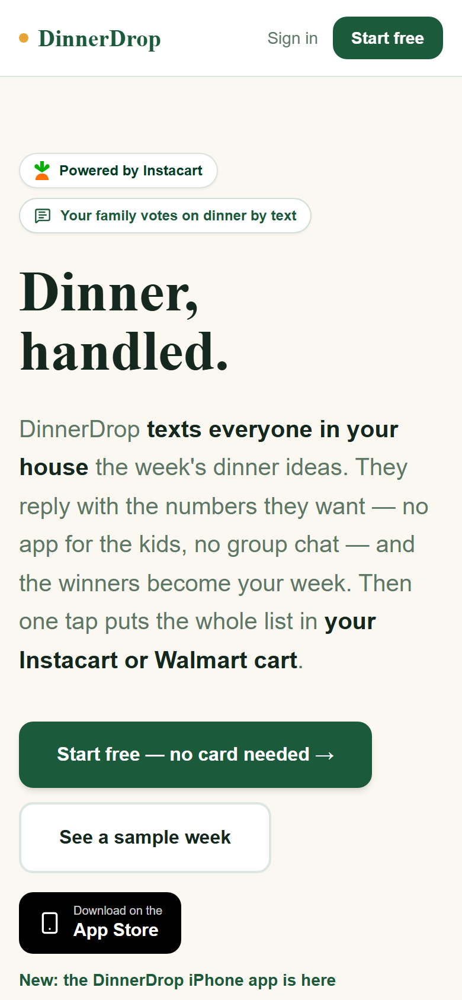
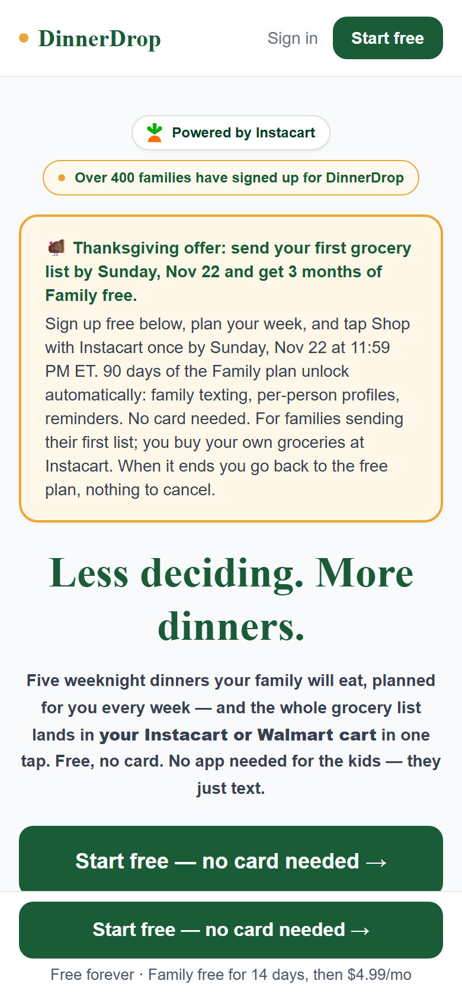
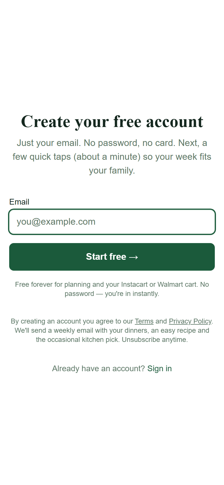

# DinnerDrop full review, November 22, 2026

Review only. No code, data, ad or account was changed, nothing was merged or deployed. Read from the latest `main` (commit `9b5708c`), the live site www.dinnerdrop.app, the public Meta Ad Library, competitors' live sites, and read-only Supabase counts (counts only, no personal data). Anything behind a sign-in was read from code and is marked that way.

Every number below is either from Sarah's last-30-day figures (Oct 23 - Nov 21) or a count I ran myself, and says which. Suggested copy uses no invented reviews, counts or results; where a real number is needed it says **[NEEDS REAL NUMBER]**.

## The basics you asked for first

- **Repo:** GitHub `giggles8d/-dinnerdrop` (package name `dinnerdrop`), Next.js 14 + Supabase + Stripe + Vercel. **There is no CLAUDE.md** in the repo (checked the root and every folder on the latest `main`). The local copy at `C:\Users\setzl\dinnerdrop` was 736 commits behind `origin/main`, so this review used a fresh copy of the latest code.
- **Supabase project:** `znxuxkqmmulnhkuwlshr`, as expected (`next.config.mjs:11`, `components/Walkthrough.tsx:35`).
- **Pricing and trials in code:**
  - **Free:** $0, no card. Weekly plan, grocery list, Instacart and Walmart cart (`lib/stripe.ts:7-9`). Nothing on the way to a first grocery send is locked.
  - **Family:** $4.99/month or $39/year with a 14-day Stripe trial that **needs a card** (`lib/stripe.ts:18-23`, `app/api/stripe/create-checkout-session/route.ts:58-75`). Adds Kroger cart push, family texting and votes, per-person profiles, reminders.
  - **`subscription_status`** is set by the Stripe webhook: `trialing` on checkout (with `trial_starts_at` and `trial_ends_at` = now + 14 days), then synced to `active`, `past_due` or `canceled` (`app/api/stripe/webhook/route.ts:50-70, 171-220`). Today: 2 accounts `active`.
  - **`family_until`** is free Family with no card. Every new sign-up gets 14 days when the first plan is built (`lib/family-grant.ts:30-41`). Offers stack on top: Thanksgiving (first list sent by tonight, Nov 22, 11:59 PM ET = 90 days), the Nov 7-8 cart offer (90 days, ended), a 92-day extension campaign (only if approved), founding members (free to Oct 18, 2027).
  - **Promo codes:** `?code=XXX` on any page sets a 30-day cookie; the dashboard redeems it once per account and adds days to `family_until` (`middleware.ts:40-52`, `lib/promo.ts:31-49`). Stripe Checkout also accepts Stripe promotion codes.
  - So there are **two different 14-day trials**: no-card free Family for everyone, and a card trial at `/subscribe`. The pages mix them up (see Part 1).
- **What fires Meta's Complete Registration:** the browser pixel fires `CompleteRegistration` (value $10) on the first page a new account lands on: `/dashboard?new=1`, `/favorites?new=1` (Mealime import) or `/subscribe?new=1` (Family path). It fires once per browser and retries for 15 seconds while the pixel loads (`components/ConversionTracker.tsx`). It fires again (value $54, no once-only guard) when Stripe sends a new Family trial back to `/dashboard?subscribed=true`. There is no server-side Conversions API. Details in Part 3.

## Your numbers, checked

| Your figure | My count | Note |
|---|---|---|
| 518 sign-ups | 519 | Time-zone edge |
| 281 tagged Facebook | 284 | Includes small campaigns (nov7_newset, weekend_nov7) and facebook.com |
| 64% finish setup | 331 of 519 (63.8%) | `profiles.onboarding_complete`. Includes anyone who tapped "Show me my dinners now" on any setup screen |
| 12% (64) reach a grocery send | 64 of 519 | Any row in `grocery_handoffs`: a cart link was made. Not a placed order |
| Meta 332 at $4.87, $1,791 spend | Doesn't tie | 332 x $4.87 = $1,617. $1,791 / 332 = $5.39. Pull both from one Ads Manager view |
| Google search 33 | 33 | 7 sent a list (21%) |

---

## The 5 biggest problems

1. **The product asks for one thing, once: "order your groceries online, right now."** 350 of 519 never open the grocery list. 107 opened it and didn't send; 90 of them had the Instacart button on screen and none tapped it. 47 of the 64 sends happen within an hour of sign-up, and only 47 families ever come back after day one. Setup never asks when or how the family shops, so there is no second chance on their real shopping day. (Part 2)
2. **Meta is buying sign-ups, not families who shop.** Every ad optimized on sign-up. Thanksgiving brought 176 sign-ups but only 14 sends (8%); oct26 brought 61 and 12 sends (20%). The real price is about **$60 per Facebook family that sent a list**. Some sign-ups think DinnerDrop delivers food ("when will it be arriving at my place"), and several asked for "our normal dinners" after seeing cauliflower rice and tofu. The grocery-send event for Meta only went in yesterday. (Parts 3, 4, 7)
3. **Trust problems on the pages people land on.** /start shows three testimonials (James L., Priya K., Amanda R.) that were written into the first code scaffold on Mar 14, before there were any users. Several pages promise "we email you on day 11", and no code sends that email. "No card needed" sits next to a Family button that leads to a card step. Switch pages still say Walmart isn't supported and the iPhone app is coming, and /ollie-alternatives still recommends Mealime, which closed Oct 21. (Parts 1, 5)
4. **You can't see the top of the funnel, and Meta can't see the bottom.** Vercel Web Analytics is off and there is no GA4, so nobody knows how many people visit /start. There is no trial or paid event and no Conversions API. 85 Facebook sign-ups before Nov 7 lost their tag to the site's own sticky button, and 60 have no source at all. (Part 3)
5. **Follow-ups skip the families closest to sending.** The day 3 and day 7 emails skip anyone who opened the list or a recipe, which is exactly the 107 who stalled at the button. The texts that push a send link to a page that needs sign-in, and web users have no password. 17 of the 151 households who got texts (11%) replied STOP. (Parts 2, 6, 7)

## The 5 first moves

1. **Tonight, before 11:59 PM ET:** check Ads Manager and any boosted posts so nothing promising "by Nov 22" or "3 months of Family free" runs tomorrow. Decide what the /start banner space shows from tomorrow (it disappears on its own). Don't approve the Thanksgiving email campaign; it has no end date.
2. **This week, no code needed:** change the two live image ads to `utm_content=512` and `utm_content=vote` so /start shows the matching headline that already exists. Judge every ad by cost per first grocery send, not cost per sign-up.
3. **Remove what isn't true:** the three invented testimonials, the "day 11 email" promise (or build the email), "Walmart isn't supported" and "iPhone app is on the way", the Mealime $2.99 recommendation and the wrong Plan to Eat claims. Make "free" mean the same thing on every ad and page.
4. **Give the send a second chance:** ask "What day do you usually shop, and how?" in setup. On that morning, send the one-tap cart link that already works without sign-in. Include stalled families in the day 3 and 7 emails. Add a "text me this list" option for in-store shoppers and count it. Build the grocery list when the plan is saved, so the list page opens instantly instead of after a 12-second spinner.
5. **Turn the lights on:** switch on Vercel Web Analytics, add a `StartTrial` event, and copy the visit source on every first page, not only the dashboard. When the first grocery send reaches about 50 a week, move Meta's optimization from sign-up to that event.

## Decisions only you can make

1. **Ad spend from tomorrow:** pause, hold at today's level, or keep spending on the two oct26 image ads while the fixes above go in? And what replaces the Thanksgiving offer: a new reward with a deadline, or nothing?
2. **What counts as success:** keep "a cart link was made" as activation, or also count "list texted to me for the store"? This changes what Meta optimizes on.
3. **Free Family:** every family gets 14 to 196 days free, and 2 accounts pay. When should a family first be asked for money?
4. **The name problem:** add a plain line ("We plan dinner and fill your grocery cart. We don't deliver food.") to ads and /start, or rethink the name? A Denver company called "Dinner Drop" also runs Meta ads.
5. **The day 11 trial email:** build it, rely on Stripe's own reminder (check the Stripe setting), or remove the promise?
6. **Vercel Web Analytics:** switch it on? It's an account change, so it's yours to make; check the plan's included events first.
7. **The approval-gated email and text campaigns** (Thanksgiving email, 92-day extension): which ones should be on?

---

## Contents

- Part 1. Public pages (390px and desktop, with screenshots)
- Part 2. Sign-up to grocery send to paywall
- Part 3. Tracking
- Part 4. Live Meta ads vs the pages they land on
- Part 5. Competitors
- Part 6. Emails, texts and Amazon links
- Part 7. What families actually said
- Skills used and skipped

Screenshots are in `docs/screenshots/` and linked as `screenshots/<name>.png`.

---

## Part 1. Public pages: live screenshots, first 5 seconds, claims, fixes

Reviewed live on 2026-11-22 (Sunday, the last day of the Thanksgiving offer). Read-only: no form was typed into or submitted. Ad and analytics beacons were answered locally during the capture, so this review added no PageViews to Meta, Google or Pinterest. Code citations are to the review clone (latest origin/main).

Screenshots: 390x844 full page (`-390`), 1440x900 full page (`-desktop`), and the first screen at 390 (`-390-fold`). Extra: `start-320-fold` (iPhone SE width). The texting-demo phone looks empty in some full-page shots. That is the looping video caught on its first frame; the poster and real playback show the thread (`components/HeroClip.tsx`, `public/vote-clip-poster.jpg`).

### The 10 things that matter most

1. **Tonight the Thanksgiving offer disappears from /start, but the ad keeps sending people there.** The banner hides itself after Sun Nov 22 11:59 PM ET (`app/start/StartClient.tsx:43-48`). "thanksgiving" was the top landing source (176 sign-ups). From midnight those clicks land on a page that never mentions the offer the ad promised. Pause or swap that ad at midnight.
2. **The page is identical for every ad.** `/start?…&c=thanksgiving`, `c=oct26`, `c=weekend-receipt` and `utm_campaign=thanksgiving` all give the same page, pixel for pixel apart from the video frame. /start only changes for `?code=`, `?angle=vote|512`, or a `utm_content` containing "vote" or "512" (`StartClient.tsx:58-66`). The weekend-receipt $5 gift-card offer ended Nov 16 (`lib/receipt-reward.ts:9-11`). Anyone still clicking that ad sees no gift card.
3. **The three testimonials on /start were placeholders from day one.** "James L.", "Priya K." and "Amanda R." (`StartClient.tsx:166-170`) first appear in the MVP scaffold commit `b45f96e` on 2026-03-14, before DinnerDrop had any users. Nothing in the repo ties them to real people. Remove them today. This is the main conversion page for paid traffic.
4. **"We email you on day 11 / three days before any charge" has no code behind it.** No cron or webhook sends a trial-ending email. The Stripe webhook handles only checkout.completed, subscription.updated/deleted and payment_failed (`app/api/stripe/webhook/route.ts:50,171,202,213`). The old trial emails were replaced with activation emails (`app/api/cron/email-sequences/route.ts:8-12`). The promise appears on /, /start, /vs/emeals, /subscribe and in Account. Either build the email, confirm Stripe's own reminder is switched on and matches the wording, or remove the promise.
5. **The Family offer contradicts itself in one card.** The card says "Every new family gets the first 14 days of Family free with no card". Its button, "Try Family free for 14 days", goes to a page that says "add a card at secure checkout" (`StartClient.tsx:211-214`, `app/(auth)/signup/page.tsx:158-162`). Both statements are true in code, because new users get 14 days automatically (`lib/family-grant.ts:4`) and the button adds a separate Stripe trial (`lib/stripe.ts:23`). A parent still reads it as "no card" followed by "card".
6. **On a phone, the /start first screen is an offer wall.** At 390 the Thanksgiving box (90 words) fills the first screen. The H1 sits under it, and the inline CTA is half covered by the sticky bar, so two identical green buttons are stacked. At 320 the H1 is not visible at all ([start-320-fold](screenshots/start-320-fold.png)). The mobile LCP element on /start is that banner paragraph, not the headline.
7. **No paid landing page shows the product.** /start has no picture or screenshot of the app, only text and emoji. Every competitor switch page (/emeals, /mealime, /maple, /ollie, /walmart) is also text only. The homepage is the only page with a product visual (the cart clip).
8. **Comparison pages are out of date and contradict the homepage.** /emeals says "Walmart isn't supported yet" and "An iPhone app is on the way" (`app/emeals/page.tsx:71-72`). /vs/emeals says "iPhone app coming", leaves Walmart out of DinnerDrop's grocery handoff, and tells Walmart shoppers to choose eMeals (`app/vs/emeals/page.tsx:24,29,77`). /ollie also says "An iPhone app is on the way" (`app/ollie/page.tsx:71`). Meanwhile the homepage says "New: the DinnerDrop iPhone app is here", and the App Store listing is live (apps.apple.com/us/app/id6824634810, checked today).
9. **The hero leads with a paid feature.** The homepage H1 pill and subhead lead with family texting ("texts everyone in your house"), but texting is Family-only after 14 days. The primary button says "Start free — no card needed". The free plan a parent signs up for is planning plus the cart.
10. **Small trust and readability problems on every page.** The gold half of each switch-page H1 has a contrast of 1.99:1 (fails WCAG even for large text). The blog's "Start free" button is white on gold at 2.08:1. The App Store badge is homemade, not Apple's artwork. Header tap targets are 43x20 ("Sign in") and 93x36 ("Start free"). "Over 400 families" undersells the real count: 518 sign-ups in the last 30 days alone.

---

### 1. Home `/`

 · [home-390](screenshots/home-390.png) · [home-desktop](screenshots/home-desktop.png)

**First 5 seconds (390 fold):**
- Who: "your house", "the kids". Busy parents, implied but never named.
- What: clear. Dinner ideas by text, the family votes, then one tap to an Instacart or Walmart cart.
- Why trust: "Powered by Instacart" pill only. No count, rating or face on the first screen. "Over 400 families" sits in small grey text below the fold (`app/page.tsx:102`).
- Next: clear. "Start free — no card needed →". But "Start free" sits next to a paid feature the hero never labels as paid.
- Desktop: strong. Real cart clip, two proof chips, clear CTA pair.

**Looks AI-made or temporary:**
- "Dinner, handled." and "Stop staring at the fridge." are generic. Any meal app could use them.
- The how-it-works photo (`public/home-feature.jpg`) is a too-perfect cutting board with a neatly handwritten "WEEKLY DINNER PLAN" note. It reads as AI or stock.
- The App Store badge is drawn with a generic phone icon (`components/AppStoreBadge.tsx:27-29`). It is not Apple's official badge, which Apple's marketing guidelines require.
- Small tracked uppercase eyebrows sit above every section ("SEE A WEEK", "HOW IT WORKS", "WHAT YOU GET", "COMPARE YOUR STORES", "FAMILY PLAN"). It is the common template look.
- The poster for the texting demo says "week of 10/19", an old date.
- The founder note has no photo and no last name.

**Claims vs code:**

| Claim | Status |
|---|---|
| "Powered by Instacart" / "Built on the Instacart Developer Platform" | Plausible. Integration code exists; partner status not verifiable from code |
| "Family texting free for 14 days, no card" | Backed (`lib/family-grant.ts:4`) |
| "Over 400 families have signed up" (`app/page.tsx:102`) | True but stale. 518 sign-ups in 30 days alone |
| "Learns what your family keeps and what it skips" (`app/page.tsx:173,179`) | Not verified in this pass. Needs a pointer to the code that does it |
| "we email you on day 11" (`app/page.tsx:264,280`) | **Not backed by code** (see top 10, #4) |
| "A real family of five in upstate New York" (store prices, `components/StorePriceExample.tsx:48`) | Per the code comment (`:11`), it is the founder's own list. Honest but vague: say whose list it is |
| "New: the DinnerDrop iPhone app is here" | Backed (App Store live) |

**Top 5 fixes:**
1. Before: "Your family votes on dinner by text" (hero pill). After: "Free weekly dinner plan + one-tap Instacart cart". Move texting to the second line: "On Family, everyone votes by text".
2. Before: "Dinner,<br />handled." After: "Five dinners planned. Groceries in your cart in one tap."
3. Before: "Over 400 families have signed up for DinnerDrop." (buried in grey). After, as a pill on the first screen: "[NEEDS REAL NUMBER] families plan dinner with DinnerDrop". Use a live count, not a hard-coded one.
4. Before: "Add a card here to keep it after that: $0 today, we email you on day 11, cancel in one tap from Account." After, until the email exists: "Add a card to keep Family after 14 days. $0 today. Your billing date is on the Account page, and you can cancel there in one tap."
5. Before: "— Sarah, founder of DinnerDrop" (no photo). After: "— Sarah [last name], founder, [town], mom of [NEEDS REAL DETAIL]", with a real photo.

---

### 2. Ad landing `/start` (and ad variants)

 · [start-390](screenshots/start-390.png) · [start-desktop](screenshots/start-desktop.png) · [start-320-fold](screenshots/start-320-fold.png)
Variants, all identical to plain /start: [thanksgiving-390](screenshots/start-thanksgiving-390.png), [thanksgiving-desktop](screenshots/start-thanksgiving-desktop.png), [oct26-390](screenshots/start-oct26-390.png), [oct26-desktop](screenshots/start-oct26-desktop.png), [weekend-receipt-390](screenshots/start-weekend-receipt-390.png), [weekend-receipt-desktop](screenshots/start-weekend-receipt-desktop.png), [utm_campaign=thanksgiving-390](screenshots/start-utm-thanksgiving-390.png), [utm_campaign=thanksgiving-desktop](screenshots/start-utm-thanksgiving-desktop.png).

**Does it change per c=?** No. Text diff and pixel diff are identical for all four variants (the only pixel difference is the video frame). The real ad URLs use `utm_campaign` (`docs/2026-10-16_Launch_Ad_Copy.md:5`), which /start ignores. The page reads only `code`/`promo` (`StartClient.tsx:25`) and `angle` or `utm_content` containing "vote" or "512" (`:58-66`). Middleware stores the campaign in the `dd_src` cookie for attribution only (`middleware.ts:133-136`). The launch-copy URL uses the non-www host, which costs one extra 307 redirect per ad click (`curl -I https://dinnerdrop.app/start` returns 307 to www).

**First 5 seconds (390 fold, today):**
- Who: not stated.
- What: today the first thing read is a 90-word Thanksgiving offer, not what DinnerDrop is. The H1 "Less deciding. More dinners." sits at the bottom of the screen and says nothing concrete. The subhead does the work.
- Why trust: "Powered by Instacart" + "Over 400 families" pills. Then three testimonials further down that are not real (see claims).
- Next: two identical "Start free — no card needed →" buttons stacked. The inline one is half hidden by the sticky bar.
- From tomorrow, the offer box is gone and the fold is pills + vague H1 + subhead + button.

**Looks AI-made or temporary:**
- Emoji icon cards 🗓️ 🛒 💰 (`StartClient.tsx:146-148`) and emoji banners 🦃 🛒 🎁.
- Initials-only testimonials with "Family of 2 / Family of 3" labels and no photos. They are classic placeholders, and they are placeholders (first commit `b45f96e`, 2026-03-14).
- Three date-bound banners stacked in one slot (Thanksgiving, receipt reward, promo), each with its own copy style.
- "Less deciding. More dinners." is a two-fragment slogan.
- No product image anywhere on the page.

**Claims vs code:**

| Claim | Status |
|---|---|
| Testimonials, James L. / Priya K. / Amanda R. (`:166-170`) | **Cannot be backed.** Added in the scaffold commit before any users existed |
| "Over 400 families have signed up" (`:98`) | True but understated |
| Thanksgiving: 90 days of Family for a first list sent by Nov 22 11:59 PM ET (`:51-52`) | Backed and matches the grant (`lib/weekend-offer-config.ts:3-7`). **Expires tonight** |
| "Family plan free for your first 14 days, no card" (`:135`) | Backed (`lib/family-grant.ts:4`) |
| "Try Family free for 14 days" → card checkout (`:211`) | Backed, but conflicts with the "no card" line right under it (`:214`) |
| "we email you on day 11" (`:214`, `:277`) | **Not backed by code** |
| "DinnerDrop learns what you keep and what you skip" (`:285`) | Not verified |
| "Priority support, answered by the founder" | Process claim. Fine if true |
| "$4.99/month or $39/year" | Backed (`app/api/stripe/create-checkout-session/route.ts:58`) |

**Top 5 fixes:**
1. Before: the three quotes ("45 minutes deciding what to cook — now it's zero." / "James L."…). After: delete the block. Replace it with one real, attributed quote from a family who sent a cart, used with permission: "[NEEDS REAL QUOTE + first name + town]". With none yet, use: "Built by Sarah, a mom who got tired of the 5pm scramble. Write to her: sarah@dinnerdrop.app".
2. Before: "Less deciding. <span>More dinners.</span>" After: "Your week of family dinners, planned free. Groceries in your Instacart or Walmart cart in one tap."
3. Before: the 90-word box "🦃 Thanksgiving offer: send your first grocery list…" After (for any future offer): one line above the H1, "Ends Sunday: send your first list, get 3 months of Family free. No card." Put the terms behind a "Details" toggle. Add a per-campaign headline, so `utm_campaign=thanksgiving` keeps a matching message after the offer ends: "Thanksgiving week, planned. Your list goes to Instacart in one tap."
4. Before: "Every new family gets the first 14 days of Family free with no card. Add a card here to keep it after that: $0 today, we email you on day 11, cancel in one tap from Account." After: "You already get Family free for 14 days when you sign up. No card. Want it to continue after that? Add a card any time: $0 today, $4.99/month from day 15, cancel in one tap." Button: "Start free (Family included for 14 days)".
5. Before: emoji cards "🗓️ Unlimited weekly plans / 🛒 One tap, in your cart / 💰 Built to your budget". After: a real screenshot of a planned week plus the filled Instacart cart, captioned "This is your first screen after sign-up", with the three lines as plain text.

---

### 3. Sign-up `/signup` (and variants)

 · [signup-390](screenshots/signup-390.png) · [signup-desktop](screenshots/signup-desktop.png)
Variants: [mobile_sticky-390](screenshots/signup-mobile-sticky-390.png), [mobile_sticky-desktop](screenshots/signup-mobile-sticky-desktop.png), [mealime-390](screenshots/signup-mealime-390.png), [mealime-desktop](screenshots/signup-mealime-desktop.png), [family-trial-390](screenshots/signup-family-trial-390.png), [family-trial-desktop](screenshots/signup-family-trial-desktop.png).

**Real parameter names** (there is no `src=`):
- The sticky bar sends `/signup?redirect=%2Fdashboard&cta=mobile_sticky` (`StartClient.tsx:316`). `cta` is not read by the sign-up page at all. Middleware also skips it, so the earlier `dd_src` is kept (`middleware.ts:110-117`).
- /mealime sends `/signup?redirect=%2Ffavorites&utm_source=mealime` (`app/mealime/page.tsx:40,91`).
- The sign-up page reads only `redirect` and `style` (`app/(auth)/signup/page.tsx:22-24`).
- Result: the mobile_sticky and mealime variants are word-for-word the same page as plain /signup. Only `redirect=/subscribe…` changes it, into the Family trial version.

**The first screen at 390:**
- Fields: one (email). No password, no name.
- Social sign-in: none. Google is hidden because the provider was never switched on (`:207-208`).
- Copy: "Create your free account" / "Just your email. No password, no card. Next, a few quick taps (about a minute) so your week fits your family." Button "Start free →". Under it: "Free forever for planning and your Instacart or Walmart cart. No password — you're in instantly." Then terms and a weekly-email notice.
- What is promised next: a ~1-minute setup, then the dashboard with a first week auto-generated (`:32-34`, `:43`).
- Family-trial variant: "Start your 14-day Family trial" / "Step 1 of 2: your email. Step 2: add a card at secure checkout — $0 today, $4.99/month after 14 days unless you cancel." It is clear and honest. It contradicts the "no card" line on the pricing card that links to it.

**First 5 seconds:** clear and low-friction. What is missing:
- No logo or brand at the top, and no link back.
- Nothing reminds visitors of the offer or source that brought them. Thanksgiving, Mealime or a promo code are not mentioned. The only banner slot is the expired Nov 7-8 `CartOfferBanner` (`components/CartOfferBanner.tsx:6`).
- No picture of what you get.
- On desktop it is a small form floating in a white void.

**Looks AI-made or temporary:** the generic "Create your free account". The input is 42px tall (just under the 44px target). The "📩 Check your inbox" fallback emoji screen.

**Top 5 fixes:**
1. Before: "Create your free account". After: "Get this week's dinners. Free." Show the source offer when there is one, e.g. "Mealime favorites: you'll add them on the next screen" or "Code OLLIE: 3 months of Family added".
2. Before: (no header). After: the DinnerDrop wordmark linking to /, plus one thumbnail of a planned week under the form, captioned "What you'll see in about a minute".
3. Before: "Free forever for planning and your Instacart or Walmart cart. No password — you're in instantly." After: "Free forever. No password, no card. Family texting is included free for your first 14 days."
4. Before: "We'll send a weekly email with your dinners, an easy recipe and the occasional kitchen pick." After: "We'll email your dinners once a week (with the odd kitchen pick). Unsubscribe in one click." This puts the affiliate-email disclosure plainly.
5. Before: `cta=mobile_sticky` (ignored). After: read `cta` and `utm_source` on the page and log them with the sign-up event, so mobile_sticky (84 sign-ups) and mealime (13) can be told apart from their ad source without a cookie race.

---

### 4. `/emeals` (switch page)

[emeals-390](screenshots/emeals-390.png) · [emeals-desktop](screenshots/emeals-desktop.png)

**First 5 seconds:** clear who (people leaving eMeals), what, offer (code EMEALS, 3 months of Family) and next step. Trust: none on screen. No product image.

**Looks AI-made or temporary:** two-tone H1 with a gold second half (contrast 1.99:1). Six identical white feature cards. "Honest differences" is useful, but it is out of date.

**Claims vs code:**

| Claim | Status |
|---|---|
| "Walmart isn't supported yet" (`app/emeals/page.tsx:71`) | **False now.** The Walmart cart ships (`components/WalmartButton.tsx`; /walmart page) |
| "An iPhone app is on the way" (`:72`) | **False now.** The app is live |
| "1,100+" recipes (`:70`) | Not verifiable from code (database count) |
| eMeals prices and "since 2003" | Dated Oct 31. Not re-checked live in this section |
| Code EMEALS: 90 days, redeem by Mar 31 2027 | Not checked in the database. Applied via `?code=EMEALS` (`:20`) |

**Top 5 fixes:**
1. Before: "eMeals connects to Walmart. DinnerDrop sends your list to Instacart (any store on Instacart) or straight into a Kroger cart. Walmart isn't supported yet." After: "Both work with Walmart. DinnerDrop fills your Walmart cart, your Instacart cart (any store on it), or on Family your Kroger cart."
2. Before: "DinnerDrop works in any phone browser and saves to your home screen. An iPhone app is on the way." After: "DinnerDrop has an iPhone app and works in any phone browser. No Android app yet."
3. Before: "Leaving eMeals? <span>Plan free, forever.</span>" (gold half unreadable). After: the same words in one dark color, or "Leaving eMeals? Plan your family's dinners free."
4. Before: (no visual). After: one screenshot of a planned week and the cart, near the import box.
5. Before: "eMeals details from eMeals' website and checkout page on October 31, 2026". After: re-check and re-date monthly, e.g. "Checked [date]".

### 5. `/vs/emeals` (comparison)

[vs-emeals-390](screenshots/vs-emeals-390.png) · [vs-emeals-desktop](screenshots/vs-emeals-desktop.png)

**First 5 seconds:** clear comparison, fair tone ("Choose eMeals if…"), two CTAs. On mobile the 3-column table is cramped. At 320 the table is 359px wide inside a 286px box, so it needs sideways scroll with no hint. No visuals.

**Claims vs code:** same stale rows as /emeals:
- "One tap to Instacart … or straight into a Kroger cart" leaves out Walmart (`app/vs/emeals/page.tsx:24`).
- "iPhone app coming" (`:29`).
- "Choose eMeals if… You shop at Walmart" (`:77`).
- "We email you three days before any charge" (`:98`) has no code behind it.

**Top 5 fixes:**
1. Before: "One tap to Instacart (any store on Instacart) or straight into a Kroger cart". After: "One tap to Walmart or Instacart (any store on it); Kroger cart on Family".
2. Before: "Works on any phone or computer; iPhone app coming". After: "iPhone app, plus any phone or computer browser".
3. Before: "You shop at Walmart for pickup or delivery." (under Choose eMeals). After: delete. Replace with "You want more than 25,000 recipes to browse."
4. Before: "We email you three days before any charge, and you can cancel in one tap." After: "Your billing date is on your Account page, and you can cancel there in one tap." (Until the email exists.)
5. Before: the table on mobile. After: stack each row as a "DinnerDrop / eMeals" pair on phones, so nothing needs sideways scrolling.

### 6. `/mealime`

[mealime-390](screenshots/mealime-390.png) · [mealime-desktop](screenshots/mealime-desktop.png)

**First 5 seconds:** clear who and why now. The "Mealime has closed" banner repeats the H1. No offer, while eMeals, Ollie and Maple visitors all get free Family months. No visual.

**Looks temporary:**
- The header wordmark here is sans-serif, unlike the serif wordmark on / and /start.
- The closed-countdown component still sits above the H1 (`components/MealimeDeadline.tsx:13-18`).
- The page leaves out the Walmart cart.

**Top 5 fixes:**
1. Before: "Mealime has closed. If you saved your favorites' names anywhere…" (banner) plus an H1 saying the same. After: drop the banner and keep the H1.
2. Before: "and then opens that list in your Instacart cart in one tap, at any store." After: "and puts that list in your Instacart or Walmart cart in one tap."
3. Before: (no offer). After: "Code MEALIME: 3 months of Family free" (middleware already captures `?code=`, `middleware.ts:41-43`), or say plainly why there is none.
4. Before: "Mealime has closed. <span>Your dinners don't have to go with it.</span>" After: one color: "Mealime closed. Bring your family's dinners here, free."
5. Before: (sans wordmark, custom header). After: use the shared `PublicHeader` like /emeals and /ollie, so the brand looks the same everywhere.

### 7. `/maple`

[maple-390](screenshots/maple-390.png) · [maple-desktop](screenshots/maple-desktop.png)

**First 5 seconds:** the strongest switch page. It has a real deadline ("8 days 13 hr until November 30"), a concrete checklist and an honest scope ("No. DinnerDrop is the dinner part"). The offer of 30 days of Family is backed: it is granted when the source is maple (`app/api/attribution/attach/route.ts:26-27`). No visual.

**Claims:** "nothing charges automatically" is backed, because promo Family needs no card. The Maple dates are attributed to Maple and "some families". Fine.

**Top 5 fixes:**
1. Before: "Maple families get 30 days of DinnerDrop Family free". After: "Maple families get 3 months of Family free". Match the eMeals and Ollie codes, or explain the difference.
2. Before: "Maple is shutting down. <span>Your family's dinners don't have to.</span>" After: one dark color.
3. Before: "fills your Instacart cart in one tap". After: "fills your Instacart or Walmart cart in one tap".
4. Before: (no visual). After: a screenshot of a planned week next to the "Bring your Maple dinners" box.
5. Before: the countdown targets Nov 30, then Dec 31 (`components/MapleDeadline.tsx:6-7`). After: put a calendar reminder to update this page on Dec 1 and on Jan 1. After Jan 1, change the H1 to "Maple has closed".

### 8. `/ollie`

[ollie-390](screenshots/ollie-390.png) · [ollie-desktop](screenshots/ollie-desktop.png)

**First 5 seconds:** clear. The code OLLIE offer is up top. No visual. The date "closed November 6" is fine.

**Claims:** "An iPhone app is on the way" (`app/ollie/page.tsx:71`) is **false now**. "1,100+ family dinners with nutrition on every one" (`:56`) cannot be checked from code.

**Top 5 fixes:**
1. Before: "DinnerDrop works in any phone browser and saves to your home screen. An iPhone app is on the way." After: "DinnerDrop has an iPhone app and works in any phone browser. Android is browser-only for now."
2. Before: "Ollie closed November 6. <span>Dinner doesn't have to stop.</span>" After: one color, "Ollie closed. Keep your family's dinners going, free."
3. Before: "the whole list in your Instacart cart in one tap". After: "the whole list in your Instacart or Walmart cart in one tap".
4. Before: (no visual). After: a screenshot of the texting thread, since Ollie users were text-first.
5. Before: "Pricing. Planning and the Instacart cart are free, always." After: "Pricing. Planning and the Instacart and Walmart carts are free."

### 9. `/ollie-alternatives` (comparison)

[ollie-alternatives-390](screenshots/ollie-alternatives-390.png) · [ollie-alternatives-desktop](screenshots/ollie-alternatives-desktop.png)

**First 5 seconds:** good. "Full disclosure: we make DinnerDrop, so it's listed first" builds trust. Sources are linked.

**Break-ui:** on a phone the 5-column table is 760px wide in a 286-358px box. Only App, Best for and part of a third column show. The Price column is never seen without a sideways swipe, and there is no scroll hint. Text is cut mid-word ("One tap to Instac…").

**Top 5 fixes:**
1. Before: the wide table on mobile. After: one card per app on phones (name, best for, grocery, texting, price).
2. Before: "UPDATED NOVEMBER 6, 2026". After: re-check competitor prices and put the real check date.
3. Before: "a Walmart cart link" (DinnerDrop row). After: "a Walmart cart" (match /walmart).
4. Before: "Families who want the week planned and the cart filled". After: "Families who want the week planned, voted on by text, and the cart filled".
5. Before: (no visual). After: a small DinnerDrop screenshot in the "Moving from Ollie" box.

### 10. `/walmart` (Walmart landing, found in app/)

[walmart-390](screenshots/walmart-390.png) · [walmart-desktop](screenshots/walmart-desktop.png)

**First 5 seconds:** very clear ("Dinner planned. Walmart cart filled."). Honest cart explanation. No visual of a Walmart cart, which is the one thing this page needs.

**Claims:** "Free forever · also works with Instacart and Kroger" (`app/walmart/page.tsx:42`) is not quite right. Kroger is Family-only. "Family members can push to a Kroger cart too" (`:68`) has the same problem.

**Top 5 fixes:**
1. Before: "Free forever · also works with Instacart and Kroger · no app to download". After: "Free forever · also works with Instacart (Kroger on Family) · iPhone app or any browser".
2. Before: "Family members can push to a Kroger cart too." After: "On the Family plan you can push to a Kroger cart too."
3. Before: (no image). After: a screenshot of the matched Walmart list with prices.
4. Before: "Dinner planned. <span>Walmart cart filled.</span>" (gold half). After: one dark color.
5. Before: "Plan my week free →" (bottom) vs "Start free — no card needed →" (top). After: one label used everywhere on the page.

### 11. `/gift` (pricing, found in app/)

[gift-390](screenshots/gift-390.png) · [gift-desktop](screenshots/gift-desktop.png)

**First 5 seconds:** clear. Prices are visible ($12 / $20 / $30), the form is long but honest, Stripe is named. No visual.

**Problem:** 3 months of Family for $12 is sold here, while the EMEALS and OLLIE codes and the Thanksgiving offer give the same 3 months free. Anyone who has seen both may feel the gift is overpriced.

**Top 5 fixes:**
1. Before: "Give a family their weeknights back". After: "Give a family 3, 6 or 12 months of planned dinners".
2. Before: "Gift DinnerDrop 🎁" (eyebrow with emoji). After: drop the emoji.
3. Before: (no picture). After: show the printable gift card the buyer gets.
4. Before: "sends it to their Instacart cart in one tap". After: "sends it to their Instacart or Walmart cart in one tap".
5. Before: "Continue to payment — $12". Keep it. Add under it: "One-time. No renewal." (It is now in small grey text.)

### 12. `/subscribe` (Family pricing)

[subscribe-390](screenshots/subscribe-390.png) · [subscribe-desktop](screenshots/subscribe-desktop.png)

It does **not** redirect to login. It is public, noindexed (`app/subscribe/layout.tsx:7`), and shows real pricing.

**First 5 seconds:** clear and honest: "Card required. $0 today. First charge of $4.99 on December 6, 2026 unless you cancel." It is the cleanest pricing on the site.

**Claims:** "We email you three days before any charge" (`app/subscribe/page.tsx:137,215`) has **no code behind it**. "save 35%" is right ($39 vs $59.88).

**Top 5 fixes:**
1. Before: "We email you three days before." After: "Your billing date is on your Account page." (until the email ships).
2. Before: "Get the whole household in on it." After: "Get the whole family voting on dinner." (says what Family is).
3. Before: "Push straight to your Kroger cart" listed first. After: lead with family texting, the feature the ads sell. Kroger second.
4. Before: "Try it free for 14 days." After: "New accounts already get 14 days free. Add a card only to keep Family after that."
5. Before: "← Keep using Free" (20px tall). After: make it a 44px button.

### 13. `/about`

[about-390](screenshots/about-390.png) · [about-desktop](screenshots/about-desktop.png)

**First 5 seconds:** clear what. Trust is thin: no founder photo, last name, town or story detail. "(with AI and a library of tested family recipes)" is honest but buried.

**Claims:** "Over 400 families" (`app/about/page.tsx:88`) understates. "tested family recipes" cannot be checked.

**Top 5 fixes:**
1. Before: "— Sarah, Founder ·". After: "— Sarah [last name], founder, [town]" with a photo.
2. Before: "Over 400 families have signed up for DinnerDrop". After: "[NEEDS REAL NUMBER] families have signed up since [month]".
3. Before: "a small, honest tool that gives families back a little time and a little sanity every week." After: one specific line from Sarah's own week, e.g. "[NEEDS REAL DETAIL: what dinner looked like before]".
4. Before: "You answer a short quiz once". After: "You answer a few questions once (about a minute)". Match the sign-up page.
5. Before: OG url `https://dinnerdrop.app/about` and image on non-www (`:11,14`). After: www, like every other page.

### 14. `/help`

[help-390](screenshots/help-390.png) · [help-desktop](screenshots/help-desktop.png)

**First 5 seconds:** good. FAQ accordion plus "Write to Sarah". Has FAQ schema.

**Top 5 fixes:**
1. Before: "Billing, trial and cancelling … Family is $4.99/month or $39/year after a 14-day trial". After: "Every new account gets Family free for 14 days, no card. To keep it: $4.99/month or $39/year."
2. Before: "Nothing is charged for your groceries by DinnerDrop; you pay the store on Instacart or Kroger." After: "…on Instacart, Walmart or Kroger."
3. Before: "Back to my week" (logged-out visitors hit sign-in). After: show it only when signed in.
4. Before: "sarah@dinnerdrop.app" link, 143x16 tap target. After: pad it to 44px tall.
5. Before: (no answer time). After: "Sarah answers within [NEEDS REAL NUMBER] hours."

### 15. `/blog` (index)

[blog-390](screenshots/blog-390.png) · [blog-desktop](screenshots/blog-desktop.png)

**First 5 seconds:** about 42 text-only cards, no images, no categories or search, newest first. Christmas and Thanksgiving posts are on top, which is seasonal and fine.

**Looks AI-made:** title formula repeats. 23 of the cards use "Actually" ("…Will Actually Eat", "That Actually Learns Your Family"). Uniform card grid. Description meta says "AI-powered tips".

**Claims:** the card "We Tried HelloFresh, Then Switched to AI Meal Planning — Here's What We Saved … saved $280/month" (`lib/blog-posts.ts:657-661`, dated May 16, before launch) is a first-person savings story. Nothing backs it. Per the honest-claims rule, either source it to a real family or rewrite it as a calculation. The bottom CTA is white on gold, contrast 2.08:1 (`app/blog/page.tsx:63`).

**Top 5 fixes:**
1. Before: "We Tried HelloFresh, Then Switched to AI Meal Planning — Here's What We Saved". After: "HelloFresh vs planning your own week: the cost math for a family of four".
2. Before: "…saved $280/month. Here's the honest breakdown." After: "Here's the math, with prices you can check."
3. Before: `bg-[#e8a838] text-white` button. After: dark text on gold (7.6:1) like the homepage.
4. Before: 42 plain cards. After: group by topic (Holiday, Budget, Picky eaters, App comparisons) and show the top 6.
5. Before: "Practical meal planning advice, dinner ideas, and AI-powered tips for busy families." After: "Weeknight dinner ideas and meal-planning help for busy families."

Other routes: `/pricing`, `/beta`, `/waitlist` 308-redirect to /start (`next.config` redirects). `/go/receipt` and `/go/texting` are signed email links and correctly noindexed.

---

### Quick technical pass (tied to conversion)

Measured with Playwright on a fast desktop line, not field data. Treat the numbers as best case.

- **Console errors:** none on any page at 390 or desktop (with ad beacons stubbed). No 4xx or 5xx responses.
- **Speed:** TTFB 135-370 ms. Mobile LCP 0.3-0.7 s on every page. On /start the LCP element at 390 and 320 is the Thanksgiving paragraph (460 ms), not the headline. The first full run showed 4 s on /start mobile; that was the texting video once scrolled into view, not a real load problem. CLS is 0 on mobile and 0.048 on /start desktop (banners mount after hydration, `StartClient.tsx:47`).
- **Weight:** home 1.3-1.5 MB, mostly the two clips (cart-clip.webm 1.0 MB, vote-clip.webm 373 KB). They now load only near the viewport (`components/HeroClip.tsx:27-33`), which is good. og-image.png is 660 KB; fine for social, but a JPG would scrape faster. /start is about 300 KB.
- **Sticky CTA:** only /start has one (`StartClient.tsx:314-323`). It has safe-area padding. On the first screen it duplicates the inline CTA and covers half of it. Hide it until the hero CTA scrolls out of view. /emeals, /mealime, /maple, /ollie and /walmart (switch traffic) have no sticky CTA on mobile.
- **Tap targets:** "Sign in" 43x20 and "Start free" 93x36 in every header. The sign-up email input is 42px tall. "Keep using Free" on /subscribe is 20px tall.
- **Horizontal overflow:** none at 390 or 320. Tables on /vs/emeals (359 in 286) and /ollie-alternatives (760 in 286) scroll inside their box with no hint.
- **Contrast:** gold H1 halves 1.99:1 on /emeals, /mealime, /maple, /ollie and /walmart. White on gold 2.08:1 (blog CTA). Gold on green 3.83:1 (blog subtitle, 18px regular, fails AA).
- **Break-ui:** the "Over 400 families…" pill wraps at 320 and leaves its gold dot orphaned on the left ([start-320-fold](screenshots/start-320-fold.png)). The /start H1 is off the first screen at 320. No long-text problems found in the copy as shipped. Forms were not typed into.
- **Meta:** every indexable page has a unique title, description, canonical and OG image. /signup and /subscribe are correctly noindexed. /start canonicalizes to itself, so promo-code URLs fold into it. Good.
  - The root layout has Offer schema; /maple and /help have FAQPage. No /start FAQ schema despite five FAQs.
  - Every switch page reuses the same generic og-image (headline "Dinner, decided by text.", faceless family photo that looks AI-made). A Mealime or Ollie share shows nothing about switching.
- **Brand consistency:** the wordmark is serif on /, /start and PublicHeader pages, and sans-serif on /mealime, /maple and /walmart (custom headers).

### Skills from the brief

- playwright-cli: USED. The CLI was not needed; I used the Playwright Node API (1.59.1) per the brief for full-page, fold, 320px and console/network capture.
- impeccable: USED. Its anti-pattern list flagged the tracked uppercase eyebrows on every section, the identical card grids and the gold-text contrast check. The setup scripts were not run (review only).
- anti-ui-slop: USED. Pushed "show the real product" over generic cards; led to finding #7 (no product visual on any paid landing page).
- design-taste-frontend: USED. Its first-screen rule (say what is sold, one hard fact, hero alone) shaped the /start fold critique. Its build and gate scripts were not run (review only).
- web-design-guidelines: USED. Its tap-target, contrast and form-label checks drove the technical pass.
- mobile-native: USED. Checked the 16px input, 44px targets, safe-area on the sticky bar (present) and the sticky bar covering the inline CTA.
- break-ui: USED, read-only. 320px viewport, table overflow and the orphaned dot on a wrapped pill. No typing into live forms, so long-email and other input cases were not tested.
- landing-page: USED. Its "never invent proof" and "one page, one goal" rules drove the testimonial finding and the offer-wall finding.
- cro: USED. Message match with the ad source led to the c=/utm_campaign test and the expiring-offer finding.
- copywriting: USED. Swap test and no-AI-tells rules for every After line. [NEEDS REAL …] used where proof is missing.
- product-marketing: USED, lightly. No `.agents/product-marketing.md` exists. Positioning was read from page copy (free planning plus cart, paid family texting), which exposed the hero leading with a paid feature.
- marketing-psychology: USED. Its dark-pattern lens on the "no card" then "card" sequence, and the anchoring problem of a $12 gift next to free 3-month codes.
- seo-audit: USED. Meta, canonical, noindex, schema and OG checks per page. Schema was read from the rendered DOM, not from fetch.
- web-perf: USED, partly. LCP, CLS, TTFB and weight came from Playwright's performance APIs. Chrome DevTools MCP traces and throttled runs were not available, so the numbers are best case.

### Screenshots saved (docs/screenshots/)

home-390.png, home-390-fold.png, home-desktop.png, start-390.png, start-390-fold.png, start-desktop.png, start-320-fold.png, start-thanksgiving-390.png, start-thanksgiving-desktop.png, start-oct26-390.png, start-oct26-desktop.png, start-weekend-receipt-390.png, start-weekend-receipt-desktop.png, start-utm-thanksgiving-390.png, start-utm-thanksgiving-desktop.png, signup-390.png, signup-390-fold.png, signup-desktop.png, signup-mobile-sticky-390.png, signup-mobile-sticky-desktop.png, signup-mealime-390.png, signup-mealime-desktop.png, signup-family-trial-390.png, signup-family-trial-desktop.png, emeals-390.png, emeals-desktop.png, vs-emeals-390.png, vs-emeals-desktop.png, mealime-390.png, mealime-desktop.png, maple-390.png, maple-desktop.png, ollie-390.png, ollie-desktop.png, ollie-alternatives-390.png, ollie-alternatives-desktop.png, walmart-390.png, walmart-desktop.png, gift-390.png, gift-desktop.png, subscribe-390.png, subscribe-desktop.png, about-390.png, about-desktop.png, help-390.png, help-desktop.png, blog-390.png, blog-desktop.png

---

## Part 2. Sign-up to grocery send to paywall

Read from code at latest origin/main (`dd-review`, HEAD 9b5708c) plus SELECT-only aggregate counts from Supabase. Nothing behind sign-in was seen live; every screen below is "read from code, not seen live". All paths are relative to the repo root.

### The short answer

Sign-up is not the problem and the paywall is not the problem. Of 519 sign-ups (Oct 23 to Nov 21), 510 reach the dashboard and all 519 get a saved week of dinners. The loss happens in two places:

1. **Between "my week is planned" and "open the grocery list": 350 of 519 (67%) never open the list.** Most of them did look: 221 scrolled half the dashboard, 214 stayed 60+ seconds. Half of the families shown "pick your week" (97 of 188) never confirm a pick.
2. **On the list page: 107 of 169 who open it never send.** 90 of those 107 had the Instacart button on screen. **Zero of the 107 tapped it.** The button works; they chose not to order online right then.

Behind both: DinnerDrop gets one session. 47 of the 64 sends happen within an hour of sign-up, and only 47 of 519 families ever come back after day one. The only "send" the product offers is "fill an online cart now", and the setup never asks how or when the family shops.

### 1. What "finish setup" and "grocery send" mean in the data

| Number | Column / event | Set where | Cohort count |
|---|---|---|---|
| 64% "finish setup" | `profiles.onboarding_complete = true` | `app/api/onboarding/walkthrough/route.ts:71` (also `app/api/onboarding/quick/route.ts:41`, `components/OnboardingQuiz.tsx:173`, `app/(app)/settings/page.tsx:335`) | 331 of 519 = 63.8% |
| 12% "grocery send" | any row in `grocery_handoffs` for the user | `app/api/instacart/route.ts:172`, `app/api/walmart/route.ts:39`, `app/api/walmart/picks/route.ts:26`, `app/api/kroger/add-to-cart/route.ts:79`, `app/api/go/shop/route.ts:48`, `app/api/deals/instacart/route.ts:38` | 64 of 519 = 12.3% |

Two things to know about these definitions:

- "Finish setup" includes anyone who tapped "Show me my dinners now" on any of the 8 walkthrough screens. That button calls the same `save()` (`components/Walkthrough.tsx:142-166`, `:172`), which sets `onboarding_complete`. So 64% means "left the walkthrough through a button", not "answered 8 screens".
- "Grocery send" is written when DinnerDrop gets a shopping link back from Instacart (or builds the Walmart cart link, or pushes to Kroger). It is not an order. Instacart account sign-in and checkout happen after the row is written, so Instacart friction does not lower the 12%.

### 2. Step map (new user, website)

1. **Landing CTA.** `/start`: "Start free — no card needed →" links to `/signup?redirect=/dashboard` (`app/start/StartClient.tsx:17`, `:131`; mobile sticky bar adds `&cta=mobile_sticky`, `:316`). The Family button goes to `/signup?redirect=/subscribe?auto=1` (`:18`, `:210`). Thanksgiving banner: "🦃 Thanksgiving offer: send your first grocery list by Sunday, Nov 22 and get 3 months of Family free." (`:51`).
2. **Middleware.** Saves `dd_src` (utm / click id / referrer) for 60 days, `dd_ref`, `dd_promo` (`middleware.ts:37-53`, `:108-139`). Signed-in users hitting `/signup` go to `/dashboard` (`:91-95`).
3. **/signup.** One field: email. Headline "Create your free account", sub "Just your email. No password, no card. Next, a few quick taps (about a minute) so your week fits your family." (`app/(auth)/signup/page.tsx:157-163`). Typo check warns once (`:50-55`). A random password is generated and never shown (`:64`); with "Confirm email" off the user is signed in on the spot and sent to `/dashboard?new=1` (`:97-101`). Existing email: falls back to a magic link and a "Check your inbox" screen (`:83-93`, `:131-150`). Google button hidden (`:207-208`). No dead end here: 510 of 519 reach the dashboard.
4. **Auth callback** (only for magic links): exchanges `code` for a session, adds `new=1` for accounts under 10 minutes old (`app/api/auth/callback/route.ts:36`, `:61-68`). Failure goes to `/login?error=auth` (`:72`), and the login page never reads `error`, so the family sees a plain sign-in form with no explanation (`grep` finds no reader of `error=auth`).
5. **Dashboard first load.** Loads profile; if no plan and `onboarding_complete` is false, shows only the walkthrough (`app/(app)/dashboard/page.tsx:224-226`, `:742-852`). `$5 gift card` sign-ups (`c=weekend-receipt`) skip setup (`:135-137`). Ad "signup" conversion fires on `new=1` (`:610`).
6. **Walkthrough, 8 screens + summary** (`components/Walkthrough.tsx`): 0 goal (`:192-217`), 1 who's at the table + optional phone (`:219-245`), 2 styles + diets (`:247-262`), 3 likes / won't eat / allergies per person (`:264-296`), 4 protein mix (`:298-337`), 5 cook nights, busy-night time, Sunday dinner (`:339-366`), 6 budget + store brands (`:368-381`), 7 family texting numbers + vote day (`:383-399`), summary "Next: pick your dinners, then one tap sends the list to Instacart or Walmart." (`:401-419`). Every screen has a pinned "Next →" and "Show me my dinners now" (`:169-174`). Answers kept in localStorage since Nov 21 (`:106-140`). No required fields. **No screen asks how or what day the family shops.**
7. **First plan.** `POST /api/first-plan` builds the week from the recipe library, no AI, and saves it (`app/api/first-plan/route.ts:23`, `lib/first-plan.ts:25-43`). It also grants 14 days of Family with no card (`lib/first-plan.ts:32`, `lib/family-grant.ts:30-41`). If the library can't fill the week, the dashboard falls back to AI `generate-plan`: Haiku, `max_tokens` 12000 (`app/api/generate-plan/route.ts:585`), client timeout 50 s, tried twice (`dashboard/page.tsx:404-435`), while the screen says "Just a few seconds." (`:871-873`). Rare: 3 `first_plan_failed`, 2 `plan_error` in the cohort.
8. **Pick your week.** For families who have never sent a list, the week opens as 12 to 15 options with the starter 5 pre-checked (`dashboard/page.tsx:261-269`, `lib/first-plan.ts:193-206`). Copy: "Pick 5 from these 15 dinners. We checked 5 to start; tap to change · 5 picked" (`:754-755`). Pinned bar: "Use these 5 →" (`:629-645`). Confirm saves the plan with `grocery_list: {}` and routes to `/grocery-list?picked=1` (`:560-566`, `:579-582`).
9. **Dashboard with a saved plan** (no options shown). Above the dinners: texting nudge, reminders, family vote card, messages, "What can I make tonight?", deals card, headcount (`:649-662`, `:853-862`). Below the dinners: cost box, savings, "Build my grocery list →" (`:956-962`). A pinned bar shows until the list is sent: "Your grocery list is ready" / "5 dinners, one list, one tap to Instacart" / "Shop my list →" (`:611-627`). Read from code: the CTA stays reachable on a 390px screen through the pinned bar; I did not render it.
10. **Grocery list page.** Every plan is saved with an empty `grocery_list` (`dashboard/page.tsx:564`, `lib/autoplan.ts:86`, `:125`, `lib/repeat-plan.ts:21`), so the first visit always calls `/api/generate-list`: Claude Haiku, `max_tokens` 6000, `maxDuration` 60 (`app/api/generate-list/route.ts:14`, `:80`; `lib/claude.ts:4`, `:10`). The page shows only a spinner and "Building your grocery list..." (`grocery-list/page.tsx:477-485`). No client timeout. On failure: "Couldn't build your grocery list" / "Try again from your dashboard." with a "Back to dashboard" button and no retry (`:487-496`).
11. **Send.** In Facebook/Instagram/TikTok browsers an amber box sits above everything: "You're in Facebook's browser" / "Instacart sign-in often fails in here, so items may not add to your cart. Open DinnerDrop in Safari first, then tap Shop ingredients." (`components/InAppBrowserNotice.tsx:242-243`, placed at `grocery-list/page.tsx:537`). Opening Safari means the family is signed out (random password, magic link only). Then the send hero: "{n} items · about ${x}" / "Amounts are matched to store package sizes, so your cart fills in ready to check out." / [Shop ingredients] / "or Walmart · Kroger ↓" (`:582-599`). Instacart: two 12 s tries (`lib/instacart.ts:179`); failure keeps them on the page with a "try again" message (`components/InstacartButton.tsx:64-68`). Walmart one-tap matches then opens the cart (`components/WalmartButton.tsx`, about 4 s). Kroger: Family only, "Kroger cart push — included with Family" (`grocery-list/page.tsx:797-800`).
12. **After send.** Recipes emailed, staples stocked, Thanksgiving offer granted (`app/api/instacart/route.ts:184-194`).
13. **Trial end / paywall.** See section 3. No paywall sits anywhere on the path to a first send.

Re-engagement paths, also read from code:
- Signed one-tap email link `/api/go/shop?u&k&s` builds the Instacart cart with no sign-in (`app/api/go/shop/route.ts:14-57`). Used by plan-ready emails (`lib/reminders.ts:144`, `:180`). Only 3 cohort families ever clicked it.
- Day 1/3/7 activation emails (`app/api/cron/email-sequences/route.ts`): days 3 and 7 skip anyone who opened a recipe or the grocery list (`:62-69`). That skips exactly the families who stalled at the send button.

### 3. Pricing and trials in code

- **Free:** $0, no card. Unlimited plans, grocery list, Instacart and Walmart carts (`lib/stripe.ts:7-9`; dashboard `canGenerate = true`, `dashboard/page.tsx:97-98`).
- **Family:** $4.99/month or $39/year, 14-day trial, card required, Stripe Checkout with promotion codes allowed (`lib/stripe.ts:18-23`; `app/api/stripe/create-checkout-session/route.ts:58-75`). The legacy $9 price stays on old subscriptions (`lib/stripe.ts:13-14`).
- **What Family unlocks:** Kroger cart push, priority support, family texting and votes, per-person profiles, cook-night reminders (`app/subscribe/page.tsx:183-191`). Nothing on the path to a first send is locked.
- **Free Family is handed out widely:**
  - Every new sign-up: 14 days of Family, no card, on first plan build (`lib/family-grant.ts:30-41`) in `family_until`.
  - Thanksgiving: first list sent by Nov 22 11:59 PM ET gives 90 days (`lib/weekend-offer-config.ts:2-8`).
  - Nov 7-8 cart offer: 90 days (`lib/cart-offer.ts`), expired.
  - When free Family ends, a campaign can add 92 more days (`lib/family-extend.ts:16`), only when approved in `app_kv`.
  - Promo codes `?code=` add `family_until` days, one per account (`lib/promo.ts:31-49`).
  - Founding members: free through Oct 18, 2027 (`lib/stripe.ts:26`).
- **`subscription_status`** (webhook `app/api/stripe/webhook/route.ts`): `checkout.session.completed` sets `trialing`, `trial_starts_at`, `trial_ends_at` = now + 14 days (`:50-70`); `customer.subscription.updated` syncs status and exact `trial_end` (`:171-196`); `deleted` sets `canceled` (`:202-208`); `invoice.payment_failed` sets `past_due` (`:213-220`).
- **When a trial ends:** Stripe trial converts to paid or cancels. Free Family (`family_until`) simply lapses back to Free. There is no in-app trial-ending screen.
- **Where the paywall appears and what it says:**
  - Dashboard banner, only when not Family and at least one plan (`dashboard/page.tsx:675-691`): "Add the whole household with Family" / "Kroger cart push, priority support, new family features first · $4.99/mo · 14 days free" / "Try Family free →". New sign-ups have free Family for 14 days, so they don't see it during the funnel.
  - `/subscribe` (`app/subscribe/page.tsx`): "Get the whole household in on it." / "Planning and your Instacart cart stay free. Family adds everything that makes dinner a shared job instead of yours alone. Try it free for 14 days." / "Start my 14-day free trial →" / "Card required. $0 today. First charge of $4.99 on {date} unless you cancel. We email you three days before." Escape link: "Keep using Free".
  - Kroger button on the list for non-Family users, with "Family is $4.99/month or $39/year after a 14-day free trial." (`grocery-list/page.tsx:813`).
  - Past due: "Payment issue — your plan is paused" (`dashboard/page.tsx:661`) and plan generation is sent to the billing portal (`:365-368`). This conflicts with `lib/access.ts:8`, which treats `past_due` as Family.
  - Inside the native app, `/subscribe`, `/go/*` and `/gift` redirect to `/account` (`middleware.ts:15-19`).
- **Result:** 2 `active` accounts. With free Family handed out for 14 to 196 days, almost nobody meets a paywall in their first month. That is a revenue question, not a reason for the send drop.

### 4. Counts (sign-ups created 2026-10-23 to 2026-11-21, SELECT-only, counts only)

| Step | Families | % of 519 |
|---|---|---|
| Sign-ups (`profiles`) | 519 | 100% |
| Dashboard viewed | 510 | 98% |
| `onboarding_complete` | 331 | 64% |
| Has a saved plan | 519 | 100% (114 got a starter week built for them) |
| Shown "pick your week" options | 188 | 36% |
| Confirmed picks and sent to list (`picked_to_list`) | 91 | 18% |
| Opened the grocery list | 169 | 33% |
| List rendered (tracked) | 135 | 26% |
| Sent a list (`grocery_handoffs`) | 64 | 12.3% |

Splits:

- **Setup done vs not:** 331 → 153 opened list → 60 sent (18%). Not done: 188 → 16 → 4 (2%).
- **Never opened the list (350):** 221 scrolled the dashboard past 50%, 214 stayed 60+ s, 160 had their plan render, 110 had a list button scroll into view, 85 had been shown the options.
- **Opened the list but never sent (107):** 90 had the Instacart button in view, 92 saw the list render, 48 stayed 60+ s, **0 tapped Instacart**, 3 tapped Walmart (none completed).
- **Picks to send:** 91 confirmed picks → 31 sent (34%).
- **Time to first send:** under 1 hour 47, 1 to 24 h 8, 1 to 7 days 7, later 2. 149 of 169 list opens happen in the first hour.
- **Came back after day one** (any dashboard, list or app event more than 24 h after sign-up): 47 of 519 (9%).
- **One-tap email shop link:** 3 families clicked, 3 carts built.
- **First store:** Instacart 48, Walmart 15, Instacart · Aldi 1.
- **List page wait** (list opened → list rendered, first visit): median 11.7 s, p90 19.0 s, 27 over 15 s. 34 opens never logged a render within 10 minutes (13 of them sent later), so some left during the spinner. Exact number unproven because of tracking gaps.
- **By source:** facebook 283 → 89 list → 30 sent (10.6%); mobile_sticky 85 → 6 (7%); none 60 → 12 (20%); google 41 → 7 (17%).
- **By campaign:** thanksgiving 176 → 78 setup (44%) → 14 sent (8%); oct26 62 → 48 (77%) → 12 (19%); search_oct26 33 → 24 → 7 (21%); weekend-receipt 28 → 15 → 1 (4%).
- **By sign-up week (setup / list / sent):** Oct 26: 75 / 58 / 26 / 11. Nov 2: 108 / 80 / 29 / 10. Nov 9: 163 / 110 / 67 / 27 (16.6% sent, best). Nov 16: 158 / 72 / 42 / 12 (7.6%), when 131 of 158 were thanksgiving sign-ups.
- **Price shock check:** median dinner estimate $69 shown as a ~$140 cart against a median $150 budget. Non-senders saw "over budget" less often than senders (101 of 455 vs 26 of 64). Price display does not explain the drop.

Exact SQL run (project znxuxkqmmulnhkuwlshr):

```sql
-- Q1 funnel
with c as (select id, created_at, onboarding_complete from public.profiles where created_at >= '2026-10-23' and created_at < '2026-11-22'),
ev as (select user_id, step, meta, created_at from public.activation_events where user_id in (select id from c))
select (select count(*) from c) as signups,
 (select count(*) from c where onboarding_complete) as onboarding_complete,
 (select count(distinct user_id) from ev where step='dashboard_view') as dashboard_view,
 (select count(distinct user_id) from ev where step='walkthrough_step') as walkthrough_seen,
 (select count(distinct user_id) from ev where step='quick_setup_done') as quick_setup_done_evt,
 (select count(distinct user_id) from public.meal_plans where user_id in (select id from c)) as has_plan,
 (select count(distinct user_id) from ev where step='first_plan_saved') as first_plan_saved,
 (select count(distinct user_id) from ev where step='first_plan_failed') as first_plan_failed,
 (select count(distinct user_id) from ev where step='first_week_options') as saw_options,
 (select count(distinct user_id) from ev where step='picked_to_list') as picked_to_list,
 (select count(distinct user_id) from ev where step='grocery_list_view') as grocery_list_view,
 (select count(distinct user_id) from ev where step='list_cta_seen') as list_cta_seen,
 (select count(distinct user_id) from ev where step='cta_tap' and meta->>'id' like 'instacart%') as instacart_tap_evt,
 (select count(distinct user_id) from public.grocery_handoffs where user_id in (select id from c)) as any_handoff,
 (select count(distinct user_id) from ev where step='plan_error') as plan_error_users;

-- Q2 splits by onboarding and source, list→send, picks→send
with c as (select id, created_at, onboarding_complete, coalesce(signup_source->>'s','(none)') src from public.profiles where created_at >= '2026-10-23' and created_at < '2026-11-22'),
lv as (select distinct user_id from public.activation_events where step='grocery_list_view' and user_id in (select id from c)),
h as (select user_id, min(created_at) first_h from public.grocery_handoffs where user_id in (select id from c) group by user_id),
pk as (select distinct user_id from public.activation_events where step='picked_to_list' and user_id in (select id from c))
select 'by_onboarding' grp, onboarding_complete::text k, count(*) n, count(*) filter (where id in (select user_id from lv)) list_view, count(*) filter (where id in (select user_id from h)) sent from c group by onboarding_complete
union all select 'by_source', src, count(*), count(*) filter (where id in (select user_id from lv)), count(*) filter (where id in (select user_id from h)) from c group by src
union all select 'list_view_then_sent', null, (select count(*) from lv), null, (select count(*) from lv where user_id in (select user_id from h))
union all select 'picked_then_sent', null, (select count(*) from pk), null, (select count(*) from pk where user_id in (select user_id from h))
union all select 'sent_without_list_view', null, (select count(*) from h where user_id not in (select user_id from lv)), null, null
order by 1,3 desc;

-- Q3 first store, time to first send, CTA taps
with c as (select id, created_at from public.profiles where created_at >= '2026-10-23' and created_at < '2026-11-22'),
fh as (select distinct on (h.user_id) h.user_id, h.store, h.created_at, c.created_at su from public.grocery_handoffs h join c on c.id=h.user_id order by h.user_id, h.created_at)
select 'first_store' k, store v, count(*) n from fh group by store
union all select 'time_to_first_send', case when created_at-su < interval '1 hour' then 'a <1h' when created_at-su < interval '24 hours' then 'b 1-24h' when created_at-su < interval '7 days' then 'c 1-7d' else 'd 7d+' end, count(*) from fh group by 2
union all select 'cta_tap', meta->>'id', count(distinct user_id) from public.activation_events where user_id in (select id from c) and step='cta_tap' group by meta->>'id'
order by 1,3 desc;

-- Q4 behaviour of non-list-openers (A) and list-openers who never sent (B)
with c as (select id from public.profiles where created_at >= '2026-10-23' and created_at < '2026-11-22'),
s as (select distinct user_id from public.grocery_handoffs where user_id in (select id from c)),
lv as (select distinct user_id from public.activation_events where step='grocery_list_view' and user_id in (select id from c)),
e as (select * from public.activation_events where user_id in (select id from c))
select 'A no_list_view: saw list CTA on dashboard' k, count(distinct user_id) n from e where step='list_cta_seen' and user_id not in (select user_id from lv)
union all select 'A no_list_view: plan_seen', count(distinct user_id) from e where step='plan_seen' and user_id not in (select user_id from lv)
union all select 'A no_list_view: dwell_60s dashboard', count(distinct user_id) from e where step='dwell_60s' and meta->>'page'='dashboard' and user_id not in (select user_id from lv)
union all select 'A no_list_view: scroll_50 dashboard', count(distinct user_id) from e where step='scroll_50' and meta->>'page'='dashboard' and user_id not in (select user_id from lv)
union all select 'A no_list_view: saw options', count(distinct user_id) from e where step='first_week_options' and user_id not in (select user_id from lv)
union all select 'A no_list_view: total', count(*) from c where id not in (select user_id from lv)
union all select 'B list_view_no_send: total', count(*) from lv where user_id not in (select user_id from s)
union all select 'B list_view_no_send: list_cta_seen on grocery-list', count(distinct user_id) from e where step='list_cta_seen' and meta->>'page'='grocery-list' and user_id in (select user_id from lv) and user_id not in (select user_id from s)
union all select 'B list_view_no_send: plan_seen on grocery-list', count(distinct user_id) from e where step='plan_seen' and meta->>'page'='grocery-list' and user_id in (select user_id from lv) and user_id not in (select user_id from s)
union all select 'B list_view_no_send: instacart tap', count(distinct user_id) from e where step='cta_tap' and meta->>'id' like 'instacart%' and user_id in (select user_id from lv) and user_id not in (select user_id from s)
union all select 'B list_view_no_send: walmart tap', count(distinct user_id) from e where step='cta_tap' and meta->>'id' like 'walmart%' and user_id in (select user_id from lv) and user_id not in (select user_id from s)
union all select 'B list_view_no_send: dwell_60s grocery-list', count(distinct user_id) from e where step='dwell_60s' and meta->>'page'='grocery-list' and user_id in (select user_id from lv) and user_id not in (select user_id from s)
union all select 'B list_view_no_send: page_closed grocery-list', count(distinct user_id) from e where step='page_closed' and meta->>'page'='grocery-list' and user_id in (select user_id from lv) and user_id not in (select user_id from s);

-- Q5 shown cart vs budget (first plan; x1.5 list ratio x1.35 delivery factor = dashboard default)
with c as (select id, weekly_budget from public.profiles where created_at >= '2026-10-23' and created_at < '2026-11-22'),
fp as (select distinct on (m.user_id) m.user_id, m.total_estimated_cost tc from public.meal_plans m join c on c.id=m.user_id order by m.user_id, m.created_at),
x as (select fp.user_id, fp.tc, nullif(regexp_replace(c.weekly_budget,'[^0-9.]','','g'),'')::numeric b, exists(select 1 from public.grocery_handoffs h where h.user_id=fp.user_id) sent from fp join c on c.id=fp.user_id)
select sent, count(*) n, round(percentile_cont(0.5) within group (order by tc)::numeric,0) median_dinner_est,
 round(percentile_cont(0.5) within group (order by tc*1.5*1.35)::numeric,0) median_shown_cart,
 round(percentile_cont(0.5) within group (order by b)::numeric,0) median_budget,
 count(*) filter (where tc*1.5*1.35 > b) shown_over_budget
from x group by sent;

-- Q6 store mode setting
with c as (select id, settings from public.profiles where created_at >= '2026-10-23' and created_at < '2026-11-22'),
s as (select distinct user_id from public.grocery_handoffs where user_id in (select id from c))
select coalesce(settings->'stores'->>'mode','(unset)') mode, count(*) n, count(*) filter (where id in (select user_id from s)) sent,
 count(*) filter (where jsonb_array_length(coalesce(settings->'stores'->'myStores','[]'::jsonb))>0) has_my_stores
from c group by 1;

-- Q7 return visits and email links
with c as (select id, created_at from public.profiles where created_at >= '2026-10-23' and created_at < '2026-11-22'),
e as (select a.* from public.activation_events a join c on c.id=a.user_id)
select 'returned_after_day1' k, count(distinct e.user_id) n from e join c on c.id=e.user_id where e.step in ('dashboard_view','grocery_list_view','app_open') and e.created_at > c.created_at + interval '24 hours'
union all select 'followup_click users', count(distinct user_id) from e where step='followup_click'
union all select 'followup_shop users (cart built from email)', count(distinct user_id) from e where step='followup_shop'
union all select 'grocery_list_view within 1h of signup', count(distinct e.user_id) from e join c on c.id=e.user_id where e.step='grocery_list_view' and e.created_at < c.created_at + interval '1 hour'
union all select 'first_plan_failed', count(distinct user_id) from e where step='first_plan_failed'
union all select 'starter_week_built', count(distinct user_id) from e where step='starter_week_built'
union all select 'quick_setup_skipped', count(distinct user_id) from e where step='quick_setup_skipped';

-- Q8 by sign-up week
with c as (select id, created_at, onboarding_complete from public.profiles where created_at >= '2026-10-23' and created_at < '2026-11-22'),
lv as (select distinct user_id from public.activation_events where step='grocery_list_view'),
s as (select distinct user_id from public.grocery_handoffs)
select to_char(date_trunc('week', created_at),'YYYY-MM-DD') wk, count(*) signups, count(*) filter (where onboarding_complete) setup_done,
 count(*) filter (where id in (select user_id from lv)) list_view, count(*) filter (where id in (select user_id from s)) sent
from c group by 1 order by 1;

-- Q9 by campaign, week of Nov 16 (same shape over the whole window = Q10)
select coalesce(signup_source->>'c','(none)') campaign, count(*) signups, count(*) filter (where onboarding_complete) setup_done,
 count(*) filter (where id in (select user_id from public.grocery_handoffs)) sent
from public.profiles where created_at >= '2026-11-16' and created_at < '2026-11-22' group by 1 order by 2 desc limit 10;

-- Q10 by campaign, whole window
select coalesce(nullif(signup_source->>'c',''),'(none)') campaign, count(*) signups, count(*) filter (where onboarding_complete) setup_done,
 count(*) filter (where id in (select user_id from public.activation_events where step='grocery_list_view')) list_view,
 count(*) filter (where id in (select user_id from public.grocery_handoffs)) sent
from public.profiles where created_at >= '2026-10-23' and created_at < '2026-11-22' group by 1 order by 2 desc limit 8;

-- Q11 list page wait (open → render)
with c as (select id from public.profiles where created_at >= '2026-10-23' and created_at < '2026-11-22'),
v as (select user_id, min(created_at) t0 from public.activation_events where step='grocery_list_view' and user_id in (select id from c) group by user_id),
r as (select v.user_id, extract(epoch from (min(a.created_at) - v.t0)) secs from v join public.activation_events a on a.user_id=v.user_id and a.created_at>=v.t0 and a.created_at < v.t0 + interval '10 minutes' and a.step in ('plan_seen','list_cta_seen') and a.meta->>'page'='grocery-list' group by v.user_id, v.t0)
select count(*) n_rendered, (select count(*) from v) n_viewed, round(percentile_cont(0.5) within group (order by secs)::numeric,1) p50_s,
 round(percentile_cont(0.9) within group (order by secs)::numeric,1) p90_s, count(*) filter (where secs > 15) over_15s from r;

-- Q12 list opens that never logged a render
with c as (select id from public.profiles where created_at >= '2026-10-23' and created_at < '2026-11-22'),
v as (select user_id, min(created_at) t0 from public.activation_events where step='grocery_list_view' and user_id in (select id from c) group by user_id),
rendered as (select distinct v.user_id from v join public.activation_events a on a.user_id=v.user_id and a.created_at>=v.t0 and a.created_at < v.t0 + interval '10 minutes' and a.step in ('plan_seen','list_cta_seen') and a.meta->>'page'='grocery-list')
select count(*) not_rendered, count(*) filter (where user_id in (select user_id from public.grocery_handoffs)) of_them_sent_ever,
 count(*) filter (where user_id in (select user_id from public.activation_events where step='page_closed' and meta->>'page'='grocery-list')) page_closed_evt
from v where user_id not in (select user_id from rendered);
```

Caveats: engagement events (`plan_seen`, `scroll_*`, `list_cta_seen`, `cta_tap`) started Oct 31, options Nov 9, `picked_to_list` Nov 10, `walkthrough_step` Nov 21 (only 1 family so far). The cohort count is 519, not 518; the difference is likely a timezone edge. `cta_tap` comes from a click listener and can miss taps, but `grocery_handoffs` is written server-side and is reliable.

### 5. Why 64% finish setup but only 12% send: ranked causes

#### Proven from code and data

1. **One session, and the ask is "order groceries online right now".** 47 of 64 sends happen within an hour of sign-up. Only 47 of 519 families (9%) ever come back after day one. The send hero offers one action, an online cart (`grocery-list/page.tsx:582-599`). 90 of the 107 who opened the list without sending had the Instacart button on screen, and none tapped it. That is a choice not to order online at that moment, not a broken button. Families who shop in person, or shop on Saturday, have nothing to "send" that counts.
2. **Setup never asks how or when the family shops.** The 8 screens cover goal, people, styles, likes, mix, nights, budget and texting (`components/Walkthrough.tsx:14-19`). Store mode exists in settings (`instore`, `lib/price-factor.ts:38-41`), but only 13 of 519 ever set it. Without a shop day there is no well-timed second prompt.
3. **The "pick your week" step loses half.** 188 were shown 12 to 15 options, and 97 never confirmed, even with 5 pre-checked (`dashboard/page.tsx:261-269`, `:754-755`). 85 of them never opened the list. Choosing 5 from 15 is a decision task placed right before the moment that matters (Hick's law).
4. **A 12-second blank wait right before the send button.** Every first list is generated by AI on page open (`grocery-list/page.tsx:256-273`, `app/api/generate-list/route.ts:80`) because every plan is saved with an empty list. Median 11.7 s, p90 19 s, spinner only, no progress or partial list, and the error screen sends the family away with no retry (`:487-496`). Up to 21 families opened the list and never saw it render.
5. **Day 3 and day 7 emails skip the stalled families.** Anyone who opened a recipe or the list counts as "activated" and gets no further nudge (`app/api/cron/email-sequences/route.ts:62-69`). Those are the 107 who stalled at the button. The one-tap signed shop link that exists (`/api/go/shop`) was used by 3 families in 30 days.
6. **Lower-intent traffic dilutes the rate.** Thanksgiving ads: 44% setup, 8% send. oct26: 77% setup, 19% send. Google search: 21% send. weekend-receipt ($5 gift card): 1 of 28. The drop from 16.6% (week of Nov 9) to 7.6% (week of Nov 16) follows the mix shift to Thanksgiving sign-ups, not a product change.
7. **The paywall is not a cause.** Planning, the list, Instacart and Walmart are free (`lib/stripe.ts:7-9`), every sign-up gets 14 days of Family free, and the upgrade banner is hidden during that time (`dashboard/page.tsx:675`).

#### Likely but unproven

8. **Facebook's in-app browser.** The amber warning sits above the send hero and tells families to leave for Safari first (`InAppBrowserNotice.tsx:242-243`). In Safari they are signed out. They have no password, so they need a magic link. The callback only does a `code` exchange (`app/api/auth/callback/route.ts:36`), so a link opened in a different browser (for example the Gmail app's viewer) likely fails and lands on `/login?error=auth` with no message. Facebook list openers send at 34% (30 of 89), others at about 43%. The gap fits this, but I can't see user agents.
9. **Ad promise mismatch.** The Thanksgiving ads (not seen by me) land on a standard 5-weeknight plan; nothing in the first week is about Thanksgiving (no Thanksgiving logic in `lib/first-plan.ts`). The lower setup rate (44%) fits, unverified.
10. **"About $140" makes the send feel like a big purchase.** Data argues against this as a main cause: non-senders saw "over budget" less often than senders. Keep it as a minor factor at most.

### 6. Top 5 fixes, ordered by expected effect on the 12%

Effect sizes are not given because we have no test data yet. [NEEDS REAL NUMBER] after an A/B test.

#### Fix 1. Give the send a second chance on the family's own shop day

The family gets one session today. Ask for the shop day and send the existing one-tap cart link (`/api/go/shop`, no sign-in) that morning by text if they gave a number, by email if not.

- Before (walkthrough screen 5 header): "Your week" / "Which nights you cook, how long you have, and Sunday dinner."
- After: add a first row to that screen. Label "When do you shop?" Choices: "Order online (Instacart or Walmart)", "I go to the store", plus a day picker "Usually on: Sat / Sun / Mon / ...".
- Before (behavior): day 1/3/7 emails by sign-up date; days 3 and 7 skip anyone who opened the list (`email-sequences/route.ts:62-69`).
- After (behavior): count only `grocery_handoffs` as activated. On shop-day morning send: "Your 5 dinners are planned. Tap once to fill your Instacart cart: [link]. Shopping in person? Here's your list: [link]."

#### Fix 2. A send that works for in-store shoppers

90 families saw "Shop ingredients" and passed. Give them a send that fits how they shop, and log it as its own store type, for example `grocery_handoffs.store = 'phone'`. Report it next to online sends, not mixed in, so the 12% stays comparable.

- Before (list hero, `grocery-list/page.tsx:585-597`): "{n} items · about ${x}" / "Amounts are matched to store package sizes, so your cart fills in ready to check out." / [Shop ingredients] / "or Walmart · Kroger ↓".
- After: "Your list is ready: {n} items for 5 dinners" / two equal buttons: [Shop ingredients] (Instacart) and [Text me this list] (or "Email me this list" if no phone) / small link "Walmart · Kroger ↓". Under the text button: "For the store. Check items off on your phone as you shop."
- Before (dashboard pinned bar): "5 dinners, one list, one tap to Instacart" / "Shop my list →".
- After: "5 dinners, one list. Order online or take it to the store." / "Get my list →".

#### Fix 3. Skip the 15-option pick screen on the first visit

Show the 5 dinners already chosen, with the send as the next step. Keep the options one tap away.

- Before (`dashboard/page.tsx:754-755`, `:633-642`): "Pick 5 from these 15 dinners. We checked 5 to start; tap to change · 5 picked" / "Use these 5 →".
- After: header "Your first 5 dinners are ready" / sub "Built from your answers. Swap any dinner, or see 10 more ideas." / primary "Get my grocery list →" / secondary "See 10 more ideas".
- Behavior: first visit shows the saved week (not `offerOptions`), with "Swap" on each card. Show options only when the family taps "See more ideas".

#### Fix 4. Make the list instant

Build the grocery list on the server when the plan is saved (`lib/first-plan.ts:39` via `savePlan`, and `confirmPlan`), or render rows straight from plan ingredients and tidy them with AI in the background.

- Before: spinner, "Building your grocery list..." for a median 11.7 s (p90 19 s). Error: "Couldn't build your grocery list" / "Something went wrong generating your list. Try again from your dashboard." / [Back to dashboard].
- After: the list and the send hero appear at once. If the AI tidy-up fails, keep the raw list and show "We couldn't merge a few duplicates. Your list still works." with [Try again] on the same page.

#### Fix 5. Stop sending Facebook users away to sign in again

Make "Open in Safari" carry the signed one-tap link, so Safari opens the cart without a DinnerDrop sign-in. Make the login page explain failed links.

- Before (`InAppBrowserNotice.tsx:242-243`): "You're in Facebook's browser" / "Instacart sign-in often fails in here, so items may not add to your cart. Open DinnerDrop in Safari first, then tap Shop ingredients." / [Open in Safari] goes to `/grocery-list` (signed-out there).
- After: put it below the send hero: "Using Facebook's browser? If Instacart won't let you sign in here, open your cart in Safari instead. No DinnerDrop sign-in needed." / [Open my cart in Safari] goes to the signed `/api/go/shop` link.
- Before (`/login?error=auth`): no message.
- After: "That sign-in link opened in a different browser or expired. Enter your email and we'll send a 6-digit code." This reuses `/api/auth/email-code`, which today is only used in the native app.

### 7. Smaller code issues found on the way

- `past_due` is "plan paused" on the dashboard (`dashboard/page.tsx:365-368`, `:661`) but counts as Family in `lib/access.ts:8`.
- The AI fallback says "Just a few seconds." (`dashboard/page.tsx:872`) while it can run 50 s × 2 tries.
- Copy, share and print on the list page are not tracked, so in-store use of the list is invisible today (`grocery-list/page.tsx:530-532`).
- The `followup_click` / `followup_shop` steps written in `app/api/go/shop/route.ts:39`, `:50` are not in `ACTIVATION_STEPS` (`lib/activation.ts:7-31`). This is harmless, but the list is out of date.

### Skills

- **signup:** USED. It confirmed the sign-up form isn't the leak (one field, instant session, 510 of 519 reach the dashboard). It pointed me at the post-submit path, where I found the magic-link `error=auth` dead end.
- **onboarding:** USED. Minimum Path to Value and "one goal per session" framed the core finding: the first session must end in the send, and the 8-screen setup plus 15-option pick sit between setup and value. Its "handling stalled users" section led to the email-skip bug.
- **paywalls:** USED. I checked every upgrade surface and trigger. Result: no paywall on the path. I also noted free Family is handed out so widely that the trial-end paywall almost never fires.
- **offers:** USED. Value-equation lens: the Thanksgiving "3 months of Family free" reward is for features the new family hasn't asked for and already has free for 14 days, so it adds little pull at the send moment. I left it out of the top 5 for that reason.
- **pricing:** USED. Documented Free vs Family ($4.99 / $39, 14-day card trial) and the free-Family grants. Concluded price is not the send blocker. Raised the revenue side (2 active paid) as a separate question.
- **churn-prevention:** USED, lightly. Its dunning section surfaced the `past_due` inconsistency. Its risk-signal idea shaped Fix 1 (shop-day trigger rather than sign-up-date emails).
- **marketing-psychology:** USED. Hick's law and default effect shaped Fix 3 (show the chosen 5, options on request). BJ Fogg (motivation × ability × prompt) shaped the main diagnosis: ability is fine (0 failed taps), the prompt arrives at the wrong time (Fix 1), and in-store shoppers have no matching action (Fix 2).

---

## Part 3. Tracking: pixel, Conversions API, sign-up event, paid event, and the 332 vs 281 gap

How I know each point: **Observed** = I saw it live (headless Chrome on www.dinnerdrop.app today, or a read-only Supabase count). **Code** = read from the latest `main`. **Inferred** = my reasoning, not proven.

### What is installed

| Piece | Status | How I know |
|---|---|---|
| Meta Pixel `2031808580404505` | Loads on every web page (not inside the phone app). PageView reached `facebook.com/tr` on `/start?utm_source=facebook&utm_campaign=thanksgiving`. `_fbp` and `_fbc` cookies set. | Observed + `app/layout.tsx:126-140` |
| Meta Conversions API (server-side) | **Not built.** No call to `graph.facebook.com` anywhere in the repo. Every Meta event is browser-only, so ad blockers and in-app browser limits lose some. | Code (searched app/, lib/, components/) |
| Meta advanced matching | No email or phone is passed to `fbq`. The pixel config request carries `im=1`, which suggests automatic advanced matching may be switched on in Events Manager. Can't confirm without the account. | Observed (config URL) + Code |
| Sign-up event | `CompleteRegistration` (value $10) fires on the first page after a confirmed account: `/dashboard?new=1`, `/favorites?new=1` (Mealime import), `/subscribe?new=1` (Family path). Once per browser (`localStorage dd_signup_conv`). Retries for 15 s while the pixel loads (fixed Oct 28). This fires on a real account, not a button click. Good. | Code: `components/ConversionTracker.tsx:34-86`, `app/(app)/dashboard/page.tsx:610`, `app/(app)/favorites/page.tsx:163`, `app/subscribe/page.tsx:71`, `app/(auth)/signup/page.tsx:40-46` |
| Paid / trial-start event | **None.** No `StartTrial`, `Subscribe` or `Purchase` anywhere. When Stripe sends someone back to `/dashboard?subscribed=true`, the same `CompleteRegistration` fires again with value $54 (`dashboard/page.tsx:608`), with no once-per-browser guard. So a Family trial counts as a second sign-up, and Meta can't tell a trial from a free account. The Stripe webhook tells no ad platform anything. | Code |
| Grocery-send event | `AddToCart` (Meta) and `cart_sent` (Google) on the first Instacart or Walmart send. **Added Nov 21, yesterday**, so none of the 30-day numbers used it, and Meta has been optimizing on sign-ups only. Kroger sends don't fire it. | Code: `lib/cart-conversion.ts`, `components/InstacartButton.tsx:73`, `components/WalmartButton.tsx:83`, git log |
| Google Ads tag `AW-18170234265` | Loads; sign-up conversion `Rv_gCJLep7YcEJmLn9hD` fires with CompleteRegistration. There is **no GA4 property**: `gtag('config')` only names the Ads account, so the `sign_up` and `cart_sent` events reach Google Ads only, and there is no web analytics report anywhere. | Observed + `app/layout.tsx:113-122` |
| Pinterest, Reddit tags | Load and send page visits; also get the sign-up event. | Observed |
| Vercel Web Analytics | The `<Analytics />` component is in the site and its script loads (HTTP 200), but the chat reports the feature is off on the Vercel project, so visits are not recorded. Turning it on is one dashboard switch. | Observed + `app/layout.tsx:164` + reported |
| First-party source | Middleware stores the visit source (utm, ad click id, or referring site) in a `dd_src` cookie for 60 days; the dashboard copies it to `profiles.signup_source` once. Confirmed live: the cookie was set to `facebook / thanksgiving / /start`. | Observed + `middleware.ts:104-140`, `app/api/attribution/attach/route.ts` |
| In-app funnel steps | `lib/activation` + `/api/track` record first-visit steps per user in Supabase. That is the best data the business has for the 64% and 12% numbers. | Code |

### Where the 518 sign-ups came from (read-only count, Oct 23 - Nov 21, `profiles.signup_source`)

| Source | Sign-ups |
|---|---|
| facebook / thanksgiving | 176 |
| facebook / oct26 | 61 |
| facebook / weekend-receipt | 28 |
| facebook / nov7_newset, weekend_nov7, no campaign, signup_button, facebook.com | 7 + 5 + 5 + 1 + 1 = 19 |
| **All Facebook-tagged** | **284** (the chat's 281 is the same thing counted a few hours earlier or with a different cut-off) |
| mobile_sticky (our own sticky "Start free" bar) | 85, **all before Nov 7** |
| no source at all | 60 (43 before Nov 7, 17 after) |
| google / search_oct26 | 33 |
| google.com (organic), chatgpt.com, mealime, google / emeals, other | 13 + 12 + 13 + 6 + about 13 |

SQL used (counts only):
```sql
select coalesce(signup_source->>'s','(none)') as source,
       coalesce(nullif(signup_source->>'c',''),'(no campaign)') as campaign, count(*)
from public.profiles
where created_at >= '2026-10-23' and created_at < '2026-11-22'
group by 1,2 order by 3 desc;
```

### Why Meta says 332 and Supabase says about 281

The gap is about 50 sign-ups (15%). That is inside the normal range for an ad platform against your own records. Nothing points to a broken pixel. Four causes, largest first:

1. **85 sign-ups lost their Facebook tag before Nov 7.** (Observed + code.) The sticky "Start free" bar links to `/signup?utm_source=mobile_sticky`, and until the Nov 6 middleware fix that internal link overwrote the ad source. All 85 `mobile_sticky` sign-ups are dated before Nov 7, and the sticky bar only shows on landing pages that ads send people to. Many of them were very likely Facebook visitors. This alone could cover the whole gap. (Inferred share.)
2. **60 sign-ups have no source at all.** The source is only copied on the dashboard (`dashboard/page.tsx:148`). Mealime importers who land on `/favorites?new=1`, or anyone whose cookie was blocked or who switched browsers, end up blank. (Code + count; share that is Facebook: unknown.)
3. **Meta also counts people who only saw an ad.** Meta's default credit window is 7 days after a click plus 1 day after a view. Someone who sees the ad, then Googles "DinnerDrop" or opens a link a friend sent, is tagged google.com or blank in Supabase but is still claimed by Meta. (Inferred from Meta's standard settings; check the "Attribution setting" column in Ads Manager to confirm.)
4. **Family trials count twice in Meta**, once at sign-up ($10) and again at `?subscribed=true` ($54). Small today because there are very few trials. (Code.)

What it is **not**: double firing on reload. The once-per-browser guard holds for free sign-ups.

**The numbers don't tie to each other either:** $1,791 / 332 = $5.39 per result, not $4.87. And 332 x $4.87 = $1,617. So the $4.87 comes from a different date range, a subset of campaigns or a different attribution setting than the $1,791. Pull both from the same Ads Manager view before comparing anything.

**The cost that matters:** by Supabase's own count, Facebook sign-ups cost about **$6.31 each** ($1,791 / 284). Only 30 of the 284 Facebook-tagged families sent a first grocery list, so the real price is about **$60 per family that sent a list** (a ceiling, since some untagged senders were probably Facebook too). What Meta has never been told is which of those families sent a grocery list. That is the number to buy.

### Top 5 tracking fixes (no changes made; each needs Sarah's OK)

1. **Optimize Meta on the grocery send, not the sign-up.** Before: every ad set optimizes on `CompleteRegistration`, so Meta finds the cheapest people who will type an email. After: once `AddToCart` (first grocery send) has about 50 events a week, switch new ad sets to optimize on it. Until then, add it as a column and judge ads by cost per grocery send. (Ads Manager change.)
2. **Add a real trial/paid event.** Before: `/dashboard?subscribed=true` fires `CompleteRegistration` $54 again. After: fire `StartTrial` (value = first month price) there, guarded once per browser. Better still, send `StartTrial` and `Purchase` from the Stripe webhook through the Conversions API, so it can't be blocked and you can send real renewals. (Code change.)
3. **Turn on Vercel Web Analytics** so landing-page visits and sign-up rate per page exist at all. Right now nobody can say what share of `/start` visitors sign up. (One switch in Vercel.)
4. **Copy the source on every first page, not only the dashboard.** Before: `attribution/attach` runs on `/dashboard` only. After: run it on `/favorites`, `/subscribe` and `/onboarding` too, so the 60 "no source" shrink. Also add a one-question "How did you hear about DinnerDrop?" on quick setup, since word of mouth and ChatGPT (12 sign-ups) can't be seen any other way. (Code change.)
5. **Build the Conversions API for the three events that matter** (sign-up, first grocery send, trial start) with shared event IDs so the pixel and the server don't double count. This recovers the 10-20% of browser events that blockers and in-app browsers drop. Only worth it after fixes 1-3.

### Skills
- conversion-tracking: USED. Ran the audit as a verification pass; separated what I saw live from what I read in code; checked that the sign-up event fires on confirmed success.
- attribution: USED. Treated Supabase as the one count, explained platform credit separately, named view-through and the overwritten tags instead of inventing a multiplier.
- analytics: USED. Found there is no GA4 property and no visit data; the funnel-step table (`lib/activation`) is the real tracking plan.

---

## Part 4. Live Meta ads vs the pages they land on

Checked Sunday, Nov 22 2026, about 10:30 to 11:30 AM ET. Read-only. No login, nothing clicked on any ad or account. Landing pages opened at 390px wide with the Meta, Google, Pinterest, TikTok and Reddit tags blocked, so this review added no fake ad visits to DinnerDrop's data.

### What I could see, and how

- **The Meta Ad Library works without login, and I saw the ads live.** Headless Playwright loaded it fine. Firecrawl and Claude in Chrome were only used to double-check one page.
- **The Page view is broken for DinnerDrop.** The DinnerDrop Page is ID 61589761471208 (lib/social.ts:3). Its `view_all_page_id` URL says "This advertiser isn't running ads in the selected country" in Playwright, Firecrawl and Chrome: https://www.facebook.com/ads/library/?active_status=all&ad_type=all&country=US&media_type=all&search_type=page&view_all_page_id=61589761471208 . Keyword search shows three active ads from that same Page, linking to facebook.com/61589761471208. So this is a Meta indexing glitch, not "no ads".
- **I found exactly 3 active DinnerDrop ads in the US.** Meta indexes each ad's link caption. An exact search for "dinnerdrop.app" returns 2 DinnerDrop ads and "www.dinnerdrop.app" returns 1. Any active ad linking to the site would show up in one of those two searches. Searches: https://www.facebook.com/ads/library/?active_status=active&ad_type=all&country=US&media_type=all&q=%22Free%20weekly%20meal%20planner%20for%20families%22&search_type=keyword_exact_phrase (all 3 ads).
- **The Thanksgiving ad and the weekend-receipt ad are not live.** I searched for their copy: "Thanksgiving" + "Instacart" (122 of about 130 results loaded), "first 50 families", "Thanksgiving week, handled", "3 months of Family", and both site captions. None returned a DinnerDrop ad. For US ads that are not about politics, the Library only shows active ads. So I cannot see these past ads. What I say about them is **from files, not seen live**.
- **There is a name collision.** A Denver meal-delivery company called "Dinner Drop" (facebook.com/getdinnerdrop, Instagram @getdinnerdrop) has 5 active ads, started Oct 26 to 29. An exact search for "DinnerDrop" shows their ads next to ours. Anyone who searches the brand on Facebook or Instagram may land on them.

### The 3 live ads

All three ran on Facebook, Instagram, Audience Network, Messenger and Threads (the platform icons on each card). Each ad has one version. None says "This ad has multiple versions".

| # | Library ID | Started | Format | Headline (under image) | CTA button | Destination as served |
|---|---|---|---|---|---|---|
| 1 | 1819698352298812 | Nov 7, 2026 | Single image, square | "Dinner planned. List in Instacart." | See details | `https://www.dinnerdrop.app/start?utm_source=facebook&utm_medium=paid&utm_campaign=oct26&utm_content=b` |
| 2 | 1781214396282180 | Nov 7, 2026 | Single image, square | "Dinner, decided by text." | See details | Same URL as ad 1 (`utm_content=b`) |
| 3 | 1464454468989228 | Nov 7, 2026 | Video, 17 s, vertical | "Everyone adds. You tap once." | Sign up | `https://www.dinnerdrop.app/start`, **no UTMs at all** |

All three have the link description "Free weekly meal planner for families". Ad 3 carries Meta's "Low impression count" label (<100 impressions in 15 days), so it is barely running.

Primary text, exact:
1. "5:12pm and nobody knows what's for dinner? Plan the whole week in 2 minutes. 5 dinners your kids will actually eat, and the grocery list opens in Instacart, every item matched. Free, no card."
2. "My kids vote on dinner by text now. The top 5 picks become the week, and the grocery list opens in Instacart in one tap. Free."
3. "Your family texts what they need ("add granola bars") and it lands on one grocery list, tagged with who asked. One tap sends the whole list to Instacart. DinnerDrop plans the dinners too. Try it free for 14 days."

Screenshots: [ad 1](screenshots/ad-1-512pm-week-in-2-min.png), [ad 2](screenshots/ad-2-kids-vote-by-text.png), [ad 3](screenshots/ad-3-family-texting-video.png). Landing first screens at 390px: [ads 1 and 2](screenshots/lp-ad-1-2-oct26-b-first-screen.png), [ad 3](screenshots/lp-ad-3-bare-start-first-screen.png). For comparison, the matched headlines the page already has but never shows to these ads: [?angle=512](screenshots/lp-start-angle-512-first-screen.png), [?angle=vote](screenshots/lp-start-angle-vote-first-screen.png).

#### The biggest message-match problem (affects all 3)

/start already has headlines written to match two of these ads. "It's 5:12pm. Dinner's already decided." shows for `?angle=512` and "Your family picks dinner by text. You tap once to shop." shows for `?angle=vote`. The code looks for those words in `angle` or `utm_content` (app/start/StartClient.tsx:57-66, 104-117). Ads 1 and 2 both send `utm_content=b` and ad 3 sends nothing, so **every Facebook visitor sees the generic "Less deciding. More dinners."** (StartClient.tsx:120-121). I confirmed this live: the `oct26&utm_content=b` URL renders the generic H1.

What a phone visitor sees first on /start today, top to bottom (390x844):
1. Nav, then "Powered by Instacart" and "Over 400 families have signed up for DinnerDrop" (StartClient.tsx:98). That number is below the 518 sign-ups in the last 30 days alone.
2. A large gold box: "🦃 Thanksgiving offer: send your first grocery list by Sunday, Nov 22 and get 3 months of Family free." plus 70 words of terms (StartClient.tsx:51-52). None of the three live ads mentions this offer, and it fills about half the first screen. It hides itself after 11:59 PM ET tonight (StartClient.tsx:43-47), so tomorrow the page gets simpler on its own.
3. The generic H1, then two identical green "Start free — no card needed →" buttons stacked (StartClient.tsx:131 and the mobile sticky bar at :316-322), with "Free forever · Family free for 14 days, then $4.99/mo" under them.

The page loaded in about 3.8 s with no sideways scroll. It is 9,100px tall at 390px wide.

---

#### Ad 1: "5:12pm" (week in 2 minutes)

**First 5 seconds**
- Who: parents of kids. Clear ("your kids").
- What: a week of dinners plus an Instacart list. Clear, and the phone mock shows a real-looking list ("$138", "Shop ingredients").
- Why trust: missing. The only signal is a designed phone mock. There are no reviews, no count of families, and no named person.
- What next: weak. The button says "See details". Meta's "Sign up" or "Get started" would tell people what happens next.

**Message match on the landing page.** "5:12pm" does not appear on the first screen. "2 minutes" does not either. The page says it once, far down: "Your first week of dinners takes two minutes." (StartClient.tsx:250). "Free, no card" matches. "Every item matched" is contradicted on the same page: the store comparison shows "6 store-brand swaps" at Aldi and "1 store-brand swap" at Tops, meaning items that store did not match exactly. Price and offer are the same ("free, no card"). Nothing in this ad is seasonal or expired.

**What looks AI-made or temporary.** The "5:12pm" hook is specific and good. The rest is template-like: "5 dinners your kids will actually eat" is a stock phrase in this category. The phone is a clean mock, not a real screenshot, and the list header says "34 items" while showing 10. Serif title, gold dot and "Free. No card." pill match the brand, so it does not look temporary.

**Top 5 fixes**
1. Destination. Before: `...utm_campaign=oct26&utm_content=b`. After: `...utm_campaign=oct26&utm_content=512` (the page then shows "It's 5:12pm. Dinner's already decided." as its H1).
2. Claim. Before: "the grocery list opens in Instacart, every item matched." After: "the grocery list opens in Instacart, ready to check out."
3. CTA. Before: "See details". After: "Sign up".
4. Headline. Before: "Dinner planned. List in Instacart." After: "5:12pm. Dinner's already planned."
5. Trust line in the primary text. Before: "Free, no card." After: "Free, no card. [NEEDS REAL NUMBER] families planned this week with DinnerDrop." Use the real count from Supabase, not "400".

#### Ad 2: "My kids vote on dinner by text"

**First 5 seconds**
- Who: parents with kids old enough to text. Clear.
- What: the family votes by text, the top 5 become the week, and the list goes to Instacart. Very clear. The chat mock with Jake, Emma and Dad replying "1 4 7 8!!" is the most concrete visual in the account.
- Why trust: it borrows a testimonial voice ("My kids vote on dinner by text now"), but the brand Page posts it. A reader who notices will feel misled.
- What next: weak ("See details").

**Message match on the landing page.** The vote headline exists but is not shown, for the same `utm_content=b` reason. The generic first screen only touches voting in "No app needed for the kids — they just text." **"Free." is not fully supported.** Family texting, which includes voting by text, needs the Family plan: app/api/sms/optin/route.ts:21 and app/api/texting/ask/route.ts:35 return "Family texting is part of the Family plan." New families get 14 days of Family with no card (lib/family-grant.ts:4). After that, voting by text costs $4.99/mo. The page's own pricing card lists Family texting under Family. So "Free." should be "Free for 14 days".

**What looks AI-made or temporary.** The first-person "My kids..." line from a brand account reads like a made-up testimonial. The creative itself looks finished and specific.

**Top 5 fixes**
1. Destination. Before: `...utm_content=b`. After: `...utm_content=vote` (the H1 then reads "Your family picks dinner by text. You tap once to shop.").
2. Offer accuracy. Before: "...the grocery list opens in Instacart in one tap. Free." After: "...the grocery list opens in Instacart in one tap. Family texting is free for 14 days, no card."
3. Voice. Before: "My kids vote on dinner by text now." After: "Your kids vote on dinner by text. The top 5 picks become the week." Or use a real parent's words with permission.
4. CTA. Before: "See details". After: "Sign up".
5. Landing page. Before (vote H1 subtext): "...the whole grocery list goes to your Instacart or Walmart cart in one tap. Free, no card." After: "...in one tap. Planning is free forever. Texting votes are free for 14 days, then $4.99/mo." The page should say the same thing as the ad.

#### Ad 3: family texting video (17 s)

**First 5 seconds** (frames at 1 s and 4 s)
- Who: households where several people add to the grocery list. Clear.
- What: "The whole family adds to the grocery list." with Maya's phone texting "add granola bars". Clear in the first second.
- Why trust: missing. It is all UI mock. No person and no proof.
- What next: "Sign up" button and an end card reading "Try it free for 14 days".

**Message match on the landing page.** Nothing on the first screen is about family members texting items. That appears only far down, in the Family pricing card and the "The whole family picks" section. The offer conflicts with the page. The ad says "Try it free for 14 days", which implies a paid product. The page leads with "Free forever" and "Start free — no card needed". Both are true, since the texting feature is Family-only (Free for 14 days, then $4.99/mo). But the visitor gets two different offers in two taps. The Instacart-only story in the ad meets "Instacart or Walmart" on the page, which is fine. Nothing is expired.

**Tracking gap.** The link has no UTMs. The middleware falls back to `fbclid` and records `s=facebook` with an empty campaign (middleware.ts:123-135). Its sign-ups land in the "other Facebook" bucket and can't be credited to this ad.

**What looks AI-made or temporary.** The video is a screen-capture style mock with captions, and the end card text sits under the play overlay. It looks like the "TestAd" renders in CoworkOutputs\AppDev (2026-11-06_DinnerDrop_Family-Texting_TestAd_Sound.mp4) rather than a finished ad. With under 100 impressions in 15 days, Meta is not spending on it.

**Top 5 fixes**
1. Destination. Before: `https://www.dinnerdrop.app/start`. After: `https://www.dinnerdrop.app/start?utm_source=facebook&utm_medium=paid&utm_campaign=oct26&utm_content=texting`, plus a matching headline on /start (today `adAngle()` only knows `vote` and `512`).
2. Offer line. Before: "Try it free for 14 days." After: "Plan dinners free. Family texting free for 14 days, no card."
3. First frame. Before: "The whole family adds to the grocery list." After: "Mom, we're out of granola bars." shown as a real text bubble in frame 1, then the list.
4. Decide its fate. It has under 100 impressions since Nov 7. Either move it into the ad set that is actually spending, or turn it off so it stops splitting the test.
5. Landing first screen for this angle. Before (H1): "Less deciding. More dinners." After: "Everyone texts the list. You tap once to shop."

---

### Ads seen only in files (not live today)

From public/ads (committed Nov 13 to 21) and CoworkOutputs\AppDev 2026-11-06_*. Strip: [screenshots/ad-files-thanksgiving-weekend-not-live.png](screenshots/ad-files-thanksgiving-weekend-not-live.png).

- **Thanksgiving (J, J2, J3), `c=thanksgiving`, 176 sign-ups.** J says "Thanksgiving week, handled. 5 easy weeknight dinners and the whole grocery list, in your Instacart cart in one tap. Try it free for 14 days. No card needed." J2 and J3 replace the footer with "Send your first list by Nov 22: 3 months of Family free". The /start banner matches J2 and J3 word for word (StartClient.tsx:51), so that was good message match. **The offer ends tonight, Nov 22, at 11:59 PM ET** (lib/weekend-offer-config.ts:5). Any copy of J2 or J3 still running tomorrow, in Meta or a boosted post, advertises an expired offer. The turkey tray photo looks AI-generated: too clean, with even browning and props placed for symmetry.
- **Weekend receipt (K, K2), `c=weekend-receipt`, 28 sign-ups.** K says "Get a $5 Instacart gift card", but the site, the banner and the rules all say a **$5 Amazon gift card** (lib/receipt-reward.ts:3, components/ReceiptRewardBanner.tsx:13, components/GiftCardStart.tsx:24). K2 fixed the wording (commit c7105cd, Nov 13). I cannot tell from files which version ran. If K ran at all, some of those 28 families were promised a different card than they got. The offer ended Nov 16 (receipts due by then), and the page banner already hides itself. The floating produce on a yellow background reads as stock or AI art.
- **Mealime.** The expired "Mealime closes Oct 21" Reddit image was retired on Nov 21 (commit 76ffba0). An exact Ad Library search for "Mealime" (about 24 active ads) shows no DinnerDrop ad, so this claim is not live on Meta.

### Tie to the numbers (last 30 days)

- **The best ad is gone, and the weakest set is what's left.** Thanksgiving brought 176 of the 281 Facebook-tagged sign-ups (63%) and ran about 9 days (its assets were made Nov 13). "oct26" brought 57 in the whole window, and only two of its ads are live. Weekend-receipt brought 28 in one weekend. The two offer-led ads (a concrete reward with a deadline) beat the evergreen "free planner" ads by a wide margin per day. That is a hypothesis, not a proven cause. The offer, the seasonal photo, and the timing all changed together.
- **Unattributed Facebook sign-ups.** 176 + 57 + 28 = 261. The other 20 Facebook-tagged sign-ups have no matching campaign. Ad 3's bare /start link and organic Facebook visits are the likely sources (middleware.ts:123-135 records `c` from `utm_campaign` only).
- **Meta says 332, Supabase says 281.** Full explanation is in Part 3 (Tracking). Short version: 85 sign-ups before Nov 7 had their Facebook tag overwritten by the site's own sticky "Start free" bar, 60 have no source at all, and Meta also credits people who only saw an ad. Audience Network placements (on for all three live ads) add view-through credit that is hard to trace.
- **The cost numbers don't add up.** 332 x $4.87 = $1,617, but total Meta spend is $1,791 (that would be $5.39 each). Per Supabase-tagged Facebook sign-up it is about **$6.31** ($1,791 / 284 by a fresh count). **Real number, not an estimate:** 30 Facebook-tagged families sent a first grocery list (thanksgiving 14 of 176, oct26 12 of 61, weekend-receipt 1 of 28, other 3 of 19). That is about **$60 per family that actually sent a list** ($1,791 / 30). It is a ceiling, since some untagged senders were probably Facebook too. By campaign, oct26 converts to a send 2.5 times better than Thanksgiving (20% vs 8%).

### Account-level fixes, in order

1. Today: confirm in Ads Manager that nothing promising "by Nov 22" or "3 months of Family free" runs after 11:59 PM ET tonight. That includes boosted posts, which the Library may not show me.
2. Change ad 1 to `utm_content=512` and ad 2 to `utm_content=vote`. That costs nothing and turns on headlines that already exist.
3. Tag ad 3 with UTMs and give it a texting headline, or pause it.
4. Make every ad say "free" the same way the page does. Planning is free forever, and texting/voting is free for 14 days.
5. Brief a post-Thanksgiving successor that keeps what worked: a concrete reward with a real deadline that matches the /start banner word for word. Test it against ad 1 on cost per first grocery send, not cost per sign-up.

Competitors seen in the same searches, active today: Grocerelle ("Send it to Instacart in one tap", "Free for 30 days, no card needed", a Thanksgiving cart ad since Nov 14) and Mealify ("Your week of meals, planned in minutes", since Nov 20). Source: https://www.facebook.com/ads/library/?active_status=active&ad_type=all&country=US&media_type=all&q=%22Instacart%20in%20one%20tap%22&search_type=keyword_exact_phrase . "One tap to Instacart" is no longer unique to DinnerDrop. Family voting by text, as in ad 2, is the angle I did not see any competitor use.

### Skills

- **ad-creative: USED.** Its spec checks shaped the review: primary text front-loaded within 125 characters (ads 1 and 3 run longer), headlines kept short, no testimonial voice the brand can't back, and "clickbait the landing page can't deliver" (the "every item matched" and "Free." findings). Its no-invented-claims rule is why fix 5 on ad 1 uses [NEEDS REAL NUMBER].
- **ads: USED.** Its landing-page alignment (headline-mirror) section drove the `utm_content` finding. Its attribution guidance ("platform attribution is inflated", compare to first-party data, never sum across windows) shaped the 332 vs 281 section. It is also why I judged on cost per first grocery send.
- **playwright-cli: USED, but I ran the Node Playwright 1.59.1 library directly** (C:\Users\setzl\node_modules\playwright) with scripts in the scratchpad (meta-ads-work\adlib.js, cards.js, creatives.js, landing.js). The `playwright-cli` command is not installed, and the brief asked for Node Playwright. The skill's headless, snapshot-first approach still guided the scripts. All screenshots in this section came from those scripts.

---

## Part 5. Competitors: live check and claim audit

Scope: Mealime, eMeals, Plan to Eat, Samsung Food. Public pages only, checked live today with Firecrawl. No sign-ups, no trials, no form submits. The eMeals signup quiz text was read as rendered page text; nothing was clicked or submitted.

Screenshots: screenshots/competitor-emeals-home.png, screenshots/competitor-plantoeat-home.png, screenshots/competitor-samsungfood-home.png.

### Bottom line

- Four of DinnerDrop's competitor claims are plainly wrong on live pages today. The biggest: /ollie-alternatives still recommends Mealime at "$2.99/month" a month after Mealime closed, and six blog spots say Plan to Eat has no cart handoff. It does.
- DinnerDrop's own facts on the eMeals pages are out of date. They still say "Walmart isn't supported yet" and "iPhone app is on the way". Walmart is live (app/walmart/page.tsx) and the iPhone app launched Nov 14 (components/AppStoreBadge.tsx:4). These lines undersell DinnerDrop.
- DinnerDrop is the cheapest paid plan of the four ($39/yr), and it is the only one with a free tier that plans the week for you and fills a store cart. It cannot win on proof, recipe count, Android, or billing trust against Plan to Eat.

### Comparison table (live today; DinnerDrop read from code)

| | DinnerDrop | eMeals | Plan to Eat | Samsung Food | Mealime |
|---|---|---|---|---|---|
| Status | Live | Live, app updated 3 days ago | Live | Live, last iOS update May 11 | Closed Oct 21, 2026 |
| Free tier | Yes: plans, list, Instacart and Walmart carts | No | No ("Why isn't there a free plan?") | Yes | Recipes moved to Meals Hub, free |
| Paid price | Family $4.99/mo or $39/yr | $59.99/yr or $37.50/qtr (checkout) | $5.95/mo or $49/yr | Food+ $6.99/mo or $59.99/yr | n/a |
| Cheapest year | $39 | $59.99 | $49 ($24.50 sale Nov 27-30) | $59.99 | $0 (Meals Hub) |
| Trial | 14 days Family, no card, auto on signup; Stripe path also 14 days but card required | 14 days, card required | 14 days, no card; yearly does not auto-renew by default; 60-day refund | 7 days, bought in the mobile app | n/a |
| Grocery handoff | Instacart, Walmart, Kroger (Kroger on Family) | Walmart, Instacart, Shipt, Amazon Fresh, Albertsons, Safeway, H-E-B, Kroger | "Send your list" to a grocery service; you pick brands and quantities there | "23 integrated retailers across 4 regions"; partners page shows Instacart, Walmart, Kroger family, Amazon | n/a |
| Who plans the week | DinnerDrop, from the family profile | eMeals: 7 recipes/week from your plan, you pick | You, from your own recipes | You; Food+ tailored 7-day plans (free users get 2) | n/a |
| Household | Per-person profiles, family texting votes (Family) | "Me + Family" sizing; allergen and protein exclusions | One account shared by the household | Shared lists and shared meal plan link | n/a |
| Proof shown | [NEEDS REAL NUMBER] | 4.6 iOS (53K), Trustpilot 4.1 (3,136), "2M+ Moms" | 4.8 iOS, 4.7 Play, "50k+ meal planners" | 4.8 iOS (6.5K), Webby nominee 2021 | "over 4,500,000" (stale page) |

DinnerDrop sources: lib/stripe.ts:18-23, lib/family-grant.ts:4 and :30, app/subscribe/page.tsx:168-179 and :215, app/api/stripe/create-checkout-session/route.ts:58-70, app/page.tsx:72, app/page.tsx:277.

### 1. Competitors, live

#### Mealime
Sources: https://www.mealime.com/ and https://www.mealime.com/closing

- Status: closed. The closing page says Mealime "will be discontinued as of October 21, 2026". Pro billing stopped and Pro features were made free before the end.
- Where users went: Meals Hub inside Albertsons Companies store apps (Safeway, Albertsons, Vons, Jewel-Osco and others). It is "100% free" and has the Mealime recipes plus more.
- Change vs Oct 29 review: that doc says Meals Hub "only exists inside" the store apps. The closing FAQ says there is also a web version through Albertsons store websites, and it works even if no Albertsons store is near you.
- Data: personal data is deleted at shutdown. Preferences must be set up again in Meals Hub. No export is described.
- Homepage first 5 seconds: still says "Meal planning made easy" and "Join over 4,500,000 others for free today" under a banner that says Mealime "will shut down" (future tense, now stale). Every download button goes to the closing page. Who: anyone. What: meal planning. Trust: 4.5M users. Next: a dead end. It reads as a live app that is not.
- Price, trial, integrations: none now.

#### eMeals
Sources: https://emeals.com/, https://emeals.com/account/start.php (quiz text, not submitted), https://emeals.com/grocery-delivery-pickup/, https://support.emeals.com/portal/en/kb/articles/how-much-does-emeals-cost, https://support.emeals.com/portal/en/kb/articles/does-emeals-provide-nutritional-information, https://apps.apple.com/us/app/emeals-healthy-meal-plans/id575756462, https://www.trustpilot.com/review/emeals.com

- Prices:
  - Checkout: Yearly $59.99 ("$4.99/mo", shown struck from $149.88, "60% Off"); Quarterly $37.50 ("$12.49/mo").
  - Help center: Dinner $35.99/3 mo or $59.99/yr; Breakfast $8.99 or $29.99; Lunch $9.99 or $39.99; All Day $39.98 or $99.98. The page says "Updated 4 years ago".
  - App Store: Dinner $37.49 and $59.99; All-Day $39.99 and $99.99. The description still says 3-month $29.99.
  - Grocery page FAQ: 3-month "for $9.99 a month".
  - eMeals publishes at least four different quarterly prices.
- Trial: "100% Free 14-day trial", then "billed annually at $59.99". A payment method is required. The checkout still shows "50% OFF FOR LIFE" and "Spin to Win!" steps.
- Headline: "Less Stress, More Dinners" / "We Plan, They Shop, You Cook."
- Claims: "More than two million customers", "Trusted by 2M+ Moms" (quiz), "Save Two Hours Every Week", "save an average of $2,000 a year", "25,000+ recipes curated by experts", 15 meal plans, dietitian-crafted recipes, media logos (Southern Living, ABC, FOX, NBC, CBS).
- Ratings: App Store 4.6 from 53K ratings; Trustpilot 4.1 from 3,136 reviews. Trustpilot flags that eMeals "Hasn't replied to negative reviews". Recent 1-star reviews still describe surprise renewals, for example a Nov 17 review titled "Automatic billing scam".
- Grocery: the homepage logo strip shows Walmart, Instacart, Publix, Kroger, Whole Foods, Albertsons, Amazon Fresh, Meijer, Aldi, Target and Safeway. The App Store description lists Walmart, Instacart, Shipt, AmazonFresh, Albertsons, Safeway, H-E-B and Kroger.
- Family features: quiz asks "Who are you cooking for?" (Just Me / Me + 1 / Me + Family), allergens, proteins to exclude, and dinners per week (1-7). The plan itself is "7 recipes - just pick the ones you want."
- First 5 seconds (screenshot): Who: parents (mother and daughter video). What: plan, shop, cook. Trust: nothing above the fold; social proof starts two screens down. Next: orange "Try Free for 14-Days". No price and no product shot above the fold.
- Changes vs Nov 1 teardown:
  - The quiz diet step now offers 10 choices (No Preference, Diabetic, Gluten-Free, Heart Healthy, High Protein, Keto, Low Calorie, Low-Carb, Mediterranean, Plant Based). It had 4 on Nov 1.
  - The shopping step now lists Walmart, Instacart, Kroger, H-E-B, AmazonFresh and Other. Instacart and Kroger were added.
  - The homepage logo strip grew to include Publix, Whole Foods, Meijer, Aldi and Target.
  - Trustpilot went from 3,129 to 3,136 reviews.
  - Prices, the 53K iOS ratings and the 4.6 score are unchanged.
  - New app versions shipped Nov 12 and about Nov 19.

#### Plan to Eat
Sources: https://www.plantoeat.com/, https://www.plantoeat.com/pricing/, https://www.plantoeat.com/tour/automated-grocery-list-maker/, https://learn.plantoeat.com/help/grocery-delivery

- Price: $5.95/month or $49/year ("4 months free"). No tiers, no add-ons, no ads. A Black Friday banner offers $24.50/year from November 27 to 30 ("Our only sale of the year"). Gift subscriptions cost $49/year.
- Trial: 14 days, "No credit card required". Yearly plans don't auto-bill at year end "unless you choose to". 60-day money-back. The page states plainly that there is no free plan.
- Headline: "Recipes, Meal Plans and Grocery Lists, All in One App". Kicker: "Better than pen and paper".
- Claims:
  - Ratings: 4.8 on the App Store and 4.7 on Google Play; "trusted by 50k+ meal planners".
  - From their own survey of 2,568 customers: 47.5% less time planning and shopping, 23% lower food cost, 46% more dinners at home.
  - Founded 2008.
- Grocery: the shopping list can be sent "to nearby stores for grocery delivery or pick-up". The help article says you then "select brands and update quantities" in the grocery service's window, and items "do not always transfer correctly". The US list of partners links to eMeals' partner list. The international option runs through Whisk, which is now Samsung Food.
- Household: "One account for the family, on as many devices as you like."
- First 5 seconds (screenshot): Who: people who already collect recipes. What: recipes, plans and lists in one app. Trust: store ratings directly under the hero. Next: "Free Trial", with "no card required" stated. This is the clearest homepage of the four.
- Not in the prior docs. First check.

#### Samsung Food
Sources: https://samsungfood.com/, https://samsungfood.com/food-plus/, https://samsungfood.com/grocery-list-app/, https://samsungfood.com/partners/, https://apps.apple.com/us/app/samsung-food-meal-planning/id1133637674

- Price: free app. Food+ is $6.99/month or $59.99/year ("Save 28%"). It has a 7-day trial, can only be bought on mobile, and the price "might differ according to your country". Food+ is free with some Samsung devices.
- Food+ features: tailored 7-day meal plans, AI recipe personalization, automated pantry list, and nutrition goal tracking, mostly "Exclusively on mobile app". The Jan 20 app release notes say tailored plans are "now available to all users". Free users can apply a full week twice.
- Headline: "Food Your Way" / "all-in-one app for recipe saving, meal planning, grocery shopping, and recipe sharing".
- Claims:
  - Ratings: "4.8 rating in the AppStore and Google Play"; the App Store shows 4.8 from 6.5K ratings.
  - Awards: Featured App of the Week, Google Play Best Everyday Essentials, Webby nominee 2021.
  - App Store copy: "over 240,000 public recipes", "23 integrated retailers across 4 regions", "5,400 public food communities with 4.5 million members".
- Grocery: "turn your shopping list into an online order (available in select countries)". The partners page lists Instacart, Walmart, Amazon, The Kroger Company and Kroger banners (Ralphs, Fred Meyer, King Soopers and others), Tesco, Sainsbury's and Ocado.
- Household: shared shopping lists. Anyone with the meal plan link "can view and edit" it.
- First 5 seconds (screenshot): Who: unclear, anyone who cooks. What: the vague "Food Your Way"; the subline does the work. Trust: the Samsung name and a 4.8 rating. Next: "Sign Up". "Free" is not said above the fold.
- Changes vs Oct 29 review: Food+ prices are the same. New since that doc: tailored weekly plans are partly free (2 uses), and the app lists 23 retailers. The iOS release pace is slower; the last listed update was May 11.

### 2. DinnerDrop's claims about these four, checked

Status key. Accurate: matches the live source today. Outdated: was true, or a DinnerDrop self-fact that has changed. Unverifiable: not shown on any public page today. Wrong: contradicted by the live source.

All of these are live on dinnerdrop.app today. I confirmed the /vs/emeals, /emeals, /ollie-alternatives, /blog/emeals-alternatives and /blog/meal-planning-app-free text with curl.

#### app/vs/emeals/page.tsx
| Line | Claim (short) | Status | Live source |
|---|---|---|---|
| :19 | "No free plan; 14-day free trial" | Accurate | emeals.com/account/start.php |
| :20 | "card or PayPal for the trial" | Accurate (card). PayPal not visible in the scrape | start.php ("Choose your payment method") |
| :21 | "$59.99 a year (shown as $4.99/mo), or $37.50 every 3 months" | Accurate | start.php |
| :22 | "7 recipes a week ... (15 plans)" | Accurate | App Store listing; emeals.com |
| :23 | Family input "Not offered" | Unverifiable (not listed is not the same as not offered) | emeals.com |
| :24 | Walmart, Kroger, Instacart, Amazon Fresh, Albertsons/Safeway, H-E-B, Shipt | Accurate | App Store description |
| :25 | Compare stores "Not offered" | Unverifiable | n/a |
| :26 | Nutrition "On 7 of the 15 plans" | Accurate (help article last updated 4 years ago) | support.emeals.com nutrition article |
| :27 | "Search recipes by an ingredient you have" | Unverifiable today (from the Nov 1 App Store screenshot) | n/a |
| :28 | "25,000+" | Accurate | start.php |
| :29 | DD "iPhone app coming" | Outdated (self): launched Nov 14 | components/AppStoreBadge.tsx:4 |
| :30 | Breakfast/lunch "Paid add-ons" | Accurate | emeals.com FAQ |
| :41 | "planned dinners since 2003" | Unverifiable (footer says "Copyright 2002-2026") | emeals.com |
| :77 | "Choose eMeals if... You shop at Walmart" | Outdated (self): DD fills Walmart carts | app/walmart/page.tsx |
| :70, :109 | "October 31, 2026" check date | Outdated: re-verified today, change the date | n/a |

#### app/emeals/page.tsx
| Line | Claim | Status | Source |
|---|---|---|---|
| :52 | eMeals "asks for a card or PayPal to start its 14-day trial" | Accurate | start.php |
| :53 | "$4.99 a month price means paying $59.99 for the year up front" | Accurate | start.php ("billed annually at $59.99") |
| :70 | "lists 25,000+ recipes" | Accurate | start.php |
| :71 | "Walmart isn't supported yet" (DD) | Outdated (self) | app/walmart/page.tsx |
| :72 | DD "An iPhone app is on the way" | Outdated (self) | AppStoreBadge.tsx:4 |
| :73 | Turn off auto-renew in eMeals account settings | Accurate | support.emeals.com ("How do you stop the auto-renew") |
| :86 | "October 31, 2026" | Outdated date | n/a |

#### app/mealime/page.tsx
| Line | Claim | Status | Source |
|---|---|---|---|
| :9, :56 | Closed Oct 21, 2026 | Accurate | mealime.com/closing |
| :9, :56 | "no export" / "no way to export your plans, favorites, or lists" | Accurate in substance (no export described; data deleted; settings re-entered in Meals Hub) | mealime.com/closing FAQ |
| :56 | Albertsons moved it into Meals Hub | Accurate | mealime.com/closing |
| :85 | "Mealime Pro was a paid upgrade" | Accurate (past) | mealime.com/closing |
| (missing) | Never says Meals Hub is free with the same recipes, on web too | Omission that a Mealime user will notice | mealime.com/closing |

#### app/ollie-alternatives/page.tsx
| Line | Claim | Status | Source |
|---|---|---|---|
| :36-39 | eMeals: Walmart, Amazon, Kroger, Instacart; "14-day free trial, from $4.99/month on a 12-month plan" | Accurate, but sourced to a rival's blog (Carly), not eMeals | emeals.com |
| :48-51 | Plan to Eat: "14-day trial, then $5.95/month or $49/year" | Accurate | plantoeat.com/pricing |
| :49 | PTE grocery: "Shopping lists ... with pantry tracking" | Incomplete: leaves out its grocery delivery send | plantoeat.com/tour/automated-grocery-list-maker |
| :54-57 | Mealime "Free; Pro is $2.99/month" listed as an alternative | Wrong: closed Oct 21, Pro billing stopped | mealime.com/closing |
| :135 | "strict diet filters on a budget: Mealime" | Wrong | mealime.com/closing |

app/maple/page.tsx and app/ollie/page.tsx name none of the four. app/ollie/page.tsx:71 repeats the outdated "An iPhone app is on the way". The homepage (app/page.tsx) and /subscribe make no competitor price claims; the homepage only links /vs/emeals at :329.

#### lib/blog-posts.ts
| Line | Claim | Status | Source |
|---|---|---|---|
| :99 | Plan to Eat "about $55 a year" | Wrong ($49/yr or $5.95/mo) | plantoeat.com/pricing |
| :115 | PTE "Sends the list to a store cart: No", "About $55/yr" | Wrong (both) | plantoeat.com grocery tour; learn.plantoeat.com/help/grocery-delivery |
| :200 | eMeals "since 2003" | Unverifiable (footer 2002) | emeals.com |
| :206 | eMeals plans include "Classic" | Wrong (not among the 15 listed today) | emeals.com footer list |
| :210-213 | No free plan; $59.99/yr; $37.50/qtr; no monthly | Accurate | start.php |
| :218 | 25,000+ recipes | Accurate | start.php |
| :219 | Partners incl. H-E-B and Shipt | Accurate | App Store |
| :220 | "4.6 stars from about 53,000 ratings" | Accurate | App Store |
| :228 | "Trustpilot (4.1 stars, about 3,100 reviews)" | Accurate (3,136) | Trustpilot |
| :229 | Nutrition on 7 of 15 plans | Accurate | support.emeals.com |
| :261 | eMeals row (price, card, 7/week, partners) | Accurate | start.php |
| :262, :274 | DD "Instacart, Kroger cart" / "no Walmart yet" | Outdated (self) | app/walmart/page.tsx |
| :263 | PTE "Free trial", "List only" | Wrong ("List only") | PTE grocery tour |
| :265 | Samsung "Free; Food+ $6.99/mo; No card; Varies by partner" | Accurate | samsungfood.com/food-plus |
| :280 | PTE "No AI planning and no cart handoff" | Wrong (cart half) | learn.plantoeat.com/help/grocery-delivery |
| :288 | Samsung "paid Food+ tier for personalized plans" | Outdated (2 tailored weeks now free) | App Store notes v5.54 |
| :381 | Mealime plans/favorites/lists will not transfer | Accurate in substance | mealime.com/closing |
| :410 | Mealime library "500+" | Unverifiable | n/a |
| :421 | PTE "$5.95/month or $49/year ... No cart handoff" | Price accurate; cart Wrong | plantoeat.com |
| :423 | Samsung "free; Food+ $6.99/month ... partners vary" | Accurate | samsungfood.com |
| :551 | eMeals "One-tap Walmart (iPhone app)", "$59.99/yr, card for trial" | Accurate (price); one-tap from Nov 1 help article, not re-checked | start.php |
| :552 | PTE "Shopping list only" | Wrong | PTE grocery tour |
| :554 | Samsung "In paid Food+ / Some stores / Free / Food+ $6.99/mo" | Accurate | samsungfood.com |
| :582 | eMeals "$59.99/year after a 14-day trial (card required)" | Accurate | start.php |
| :584 | eMeals "20,000+ recipes" | Outdated (25,000+ at checkout; conflicts with :218) | start.php |
| :587 | "Planning happens in the app (little on the web)" | Accurate | emeals.com FAQ |
| :591 | PTE "$5.95/month or $49/year (14-day free trial, no card)" | Accurate | plantoeat.com/pricing |
| :596 | PTE "No grocery cart integration" | Wrong | PTE grocery tour |
| :609 | Samsung "Free (Food+ $6.99/month or $59.99/year)" | Accurate | samsungfood.com/food-plus |
| :613 | Samsung "Instacart integration in some markets" | Accurate | samsungfood.com/partners |
| :614 | "AI is paywalled"; imported recipes link back for instructions | First part Outdated; second Unverifiable today (dev replies date from 2022-2023) | App Store |
| :1544 | Mealime closed Oct 21 | Accurate | mealime.com/closing |
| :1548 | PTE "14-day free trial only", no free tier | Accurate | plantoeat.com/pricing |
| :1566 | Samsung "AI personalization and weekly planning sit in Food+" | Outdated | App Store notes v5.54 |
| :1568 | Samsung "No AI meal generation", "No store integration or cart handoff" | Wrong (also contradicts :613) | App Store description; samsungfood.com/partners |
| :1583 | One-tap cart "requires a paid tier on nearly every app" | Wrong for Samsung Food, whose free tier lists grocery delivery | App Store description |
| :1585 | Budget planning "requires premium on Mealime" | Outdated (closed) | mealime.com/closing |
| :1587 | "$6–$15/month on any existing app" | Unverifiable | n/a |
| :1619 | "willing to pay $5–$15/month immediately → Plan to Eat or eMeals" | Wrong (PTE trial needs no payment) | plantoeat.com/pricing |
| :1892 | PTE one-tap store handoff "No" | Wrong | PTE grocery tour |
| :1893 | PTE "$5.95/mo"; Samsung "Free / Food+ $6.99" | Accurate | both pricing pages |

Tally across these rows (a split row counts toward both statuses): Accurate 38, Outdated 12, Unverifiable 8, Wrong 14, plus 2 incomplete or omitted. Seven "Wrong" rows are the same Plan to Eat cart error, and one more is its price. Two are Mealime still recommended on /ollie-alternatives.

One more internal mismatch that will hurt trust on any comparison page:
- /vs/emeals:21 and :98 say Family's 14 days need "no card". That matches lib/family-grant.ts:30.
- /subscribe:215 says "Card required. $0 today." for the same 14-day Family trial.
- A visitor who reads the eMeals comparison and then clicks through to /subscribe sees the very thing DinnerDrop criticizes eMeals for.

### 3. DinnerDrop's price and trial, from code

- Free: $0, no card. Includes unlimited plans, the list, and the one-tap Instacart and Walmart carts (app/page.tsx:277, lib/stripe.ts:8).
- Family: $4.99/month or $39/year (lib/stripe.ts:18-21). The yearly toggle says "save 35%" (app/subscribe/page.tsx:160). That is correct: $39 vs $59.88.
- Trial path A, automatic: 14 days of Family on the first dashboard load, no card (lib/family-grant.ts:4, :30). Read from code, not seen live.
- Trial path B, Stripe Checkout: 14-day trial with a card required. It auto-converts. DinnerDrop emails 3 days before (lib/stripe.ts:23; app/api/stripe/create-checkout-session/route.ts:67; app/subscribe/page.tsx:215).
- Switch offers: EMEALS and OLLIE give 90 days of Family with no card (app/emeals/page.tsx:86). Maple gives 30 days (lib/maple-offer.ts:8). Founding families are free until Oct 18, 2027 (lib/stripe.ts:26).
- Real-world check: 2 accounts are marked paid, unconfirmed in Stripe. Price is not the bottleneck yet. Activation is: 12% reach a first grocery send.

Pricing read (pricing skill): DinnerDrop has fewer than 10 paying customers, so this is the before-10 stage. $39/yr is the lowest paid price of the four, and $4.99 month-to-month undercuts every monthly option. The skill's rule is that a price nobody pushes back on is too low, and these customers already pay $49-$60 elsewhere. Do not cut further. Before raising, remove the card-vs-no-card confusion and get to 10 payers. Watch Plan to Eat's $24.50 sale on Nov 27-30. It is DinnerDrop's Black Friday window too. Don't race it on price; say what $39 buys that a recipe box doesn't.

### 4. Positioning: where DinnerDrop can honestly win, and where it can't

#### Can win (supported by what was seen today)
1. **Plans the week for you, free.** eMeals plans but has no free tier. Plan to Eat and Samsung Food free users plan by hand (Samsung gives 2 tailored weeks free). DinnerDrop's free tier generates the week and fills a cart. Say it as "free to plan and fill your cart", not "the only AI planner".
2. **A cart, not a list.** Plan to Eat's own help page says you "select brands and update quantities" after sending, and items "do not always transfer correctly". If DinnerDrop's matched cart is reliable, that is a concrete contrast. It must be true in practice first: only 64 of 518 sign-ups reached a first grocery send.
3. **The whole household votes by text.** Not listed on any of the four sites today. Samsung Food has shared lists and plan links; Plan to Eat shares one account. Phrase it as "none of these list family voting by text (checked Nov 22)".
4. **Price vs eMeals.** $39/yr vs $59.99/yr, monthly vs prepaid, and a no-card start vs a card-required trial. This is the cleanest win on the page today.
5. **Mealime and Ollie leavers.** Mealime users have a free home in Meals Hub, so DinnerDrop's pitch there must be the cart at any store and family voting, not "your app is gone".

#### Can't win (don't claim it)
1. **Proof.** eMeals: 53K iOS ratings and "2M+". Samsung: 6.5K ratings at 4.8. Plan to Eat: 4.8 and 4.7 plus a 2,568-person survey. DinnerDrop: [NEEDS REAL NUMBER]. Don't fill this with invented counts.
2. **Recipe depth.** 1,100+ vs eMeals 25,000+ and Samsung's 240,000 public recipes.
3. **Billing trust vs Plan to Eat.** No card for the trial, no auto-renew on yearly by default, and a 60-day refund. DinnerDrop's Stripe path is card-required and auto-converts. Only use "no surprise charges" against eMeals, never in a four-way table.
4. **Android.** All three live rivals have Android apps; DinnerDrop has iPhone and web.
5. **Recipe collectors.** Plan to Eat and Samsung Food are built for saving your own recipes. DinnerDrop's import works but is not the core.

### Top 5 fixes to the comparison pages

1. **Remove Mealime as a live alternative (app/ollie-alternatives/page.tsx:54-57, :135, :8).**
   - Before: "Free; Pro is $2.99/month" and "You need strict diet filters on a budget: Mealime."
   - After (row): Samsung Food | "Save recipes from any site and plan the week yourself" | "Shopping lists; online ordering in select countries" | "No" | "Free; Food+ $6.99/month or $59.99/year after a 7-day trial". Source: samsungfood.com/food-plus.
   - After (choose line): "You want a free recipe box: Samsung Food. Mealime closed on October 21, 2026; its recipes moved to Meals Hub, free in Albertsons-family store apps and websites."
   - Also re-source the eMeals row to emeals.com, not the Carly blog.

2. **Fix every Plan to Eat cart and price claim (lib/blog-posts.ts:99, :115, :263, :280, :421, :552, :596, :1619, :1892).**
   - Before: "It's a paid app (about $55 a year)" / "List only" / "No grocery cart integration."
   - After: "Plan to Eat is $5.95 a month or $49 a year after a 14-day trial with no card. You plan from your own saved recipes. It can send your list to a grocery service; you then choose brands and quantities there."
   - Change the table cell from "List only" to "Sends the list; you pick products".
   - Make this one shared data entry so the nine copies can't drift again (competitors skill, "single source of truth").

3. **Update DinnerDrop's own facts on the eMeals pages (app/emeals/page.tsx:71-72, app/vs/emeals/page.tsx:29, :77, lib/blog-posts.ts:262, :274, app/ollie/page.tsx:71).**
   - Before: "eMeals connects to Walmart. DinnerDrop sends your list to Instacart (any store on Instacart) or straight into a Kroger cart. Walmart isn't supported yet."
   - After: "Both work with Walmart. DinnerDrop fills a Walmart or Instacart cart for free, and a Kroger cart on Family. eMeals also lists Amazon Fresh, Albertsons, Safeway, H-E-B and Shipt."
   - Before: "An iPhone app is on the way." After: "DinnerDrop has an iPhone app and works in any browser. No Android app yet."
   - Before (/vs/emeals:77): "You shop at Walmart for pickup or delivery." After: "You shop at Amazon Fresh, H-E-B or Shipt."

4. **Make the Samsung Food lines agree with Samsung's own pages (lib/blog-posts.ts:1566, :1568, :1583, :288, :614).**
   - Before: "No AI meal generation. The grocery list is manual ... No store integration or cart handoff."
   - After: "Free: save recipes, plan the week, share lists, and order groceries online in select countries (its App Store page lists 23 retailers in 4 regions). Food+ ($6.99/month or $59.99/year) adds tailored 7-day plans; free users can try a tailored week twice."
   - Before (:1583): "Sending your list directly to Instacart or Kroger requires a paid tier on nearly every app that offers it." After: delete the line, or "Few free apps build the week and fill a cart for you."

5. **Replace unverified "Not offered" rows and stale dates on /vs/emeals (app/vs/emeals/page.tsx:23, :25, :41, :70, :109; lib/blog-posts.ts:206, :584).**
   - Before: "Not offered" / "eMeals has planned dinners since 2003" / "eMeals details from ... October 31, 2026".
   - After: "Not listed on eMeals' site" / "eMeals has planned dinners since the early 2000s" / "eMeals details checked on eMeals' website, help center, checkout and App Store page on November 22, 2026."
   - Drop "Classic" from the plan list at :206 and change "20,000+" to "25,000+" at :584.
   - Same pass: make /subscribe:215 and /vs/emeals:21 say the same thing about whether Family's 14 days need a card.

### What looks AI-made, generic or temporary
- Comparison pages repeat the same feature cards ("Snap the fridge", "Compare your stores") across /emeals, /ollie and /maple. That reads templated.
- /ollie-alternatives sources its rivals' prices to another startup's blog post.
- The blog copies one competitor fact into up to nine places. That is how the Plan to Eat error spread.

### Skills
- competitor-profiling: USED. It set the profile fields, the observed vs inferred split, and "not observed is not absent". That is why "Not offered" rows are Unverifiable, not Accurate. I did not create raw-data folders; this brief is review-only and asks for one section file.
- competitors: USED. Its asset audit (list claim, re-verify, mark status, prioritize public pages) is section 2. Its "single source of truth" rule drives fix 2.
- reverse-engineer-marketing: USED, light (Quick mode only). The dated move log came from the eMeals App Store version history, quiz changes since Nov 1, and Samsung's release notes. No paid SEO pulls, no sign-ups (stage 3 skipped by rule), and no growth-curve claims.
- pricing: USED. It placed DinnerDrop in the before-10-customers stage and advised against cutting below $39. It also flagged the card/no-card trial mismatch as the thing to fix before any price test.

---

## Part 6. Emails, texts and Amazon links

Review only. Everything below is read from code on origin/main (commit 9b5708c), not seen live. No email or text was sent, rendered to a real inbox, or triggered. Whether each approval-gated campaign is switched on lives in Supabase `app_kv`; my brief did not include database access, so "if approved" means "not checked".

### Part A: what a new user receives

#### How sending works (short)

- Only two Vercel crons exist (vercel.json): `/api/cron/daily` at 12:00 UTC (8 AM EST) and `/api/cron/grow-library`. The daily one fans out to reminders, the day 1/3/7 activation emails, campaigns, order follow-ups and upkeep (app/api/cron/daily/route.ts:10-56).
- A second clock is the "texting poll" every 2 minutes from Supabase pg_cron (app/api/sms/poll/route.ts:16-66). It sends the welcome email, the starter-week email, the Sunday Drop sweep, late "your week" texts, the held SMS outbox (`sms_outbox`, supabase/migrations/040_sms_outbox.sql) and the standing cart-ask email.
- New accounts default to: email reminders on, automatic plan every Saturday (`planDay: 'sat'`), plan-ready by email, shop reminder off, cook-tonight off, texting off (lib/settings.ts:157-167). New accounts also get 14 days of Family free on first dashboard load (lib/family-grant.ts:29-41).
- Sign-up is instant with no confirmation email (app/(auth)/signup/page.tsx:59-69). Returning web users sign in by Supabase magic link. Supabase's own auth email templates are not in the repo (no supabase/templates), so their subject, sender and copy were not reviewed.

#### Timeline (default new user, email only, texting off)

| When | Message | Sender | Trigger and condition | Subject | Preview text | Main CTA and link | Pushes first grocery send? |
|---|---|---|---|---|---|---|---|
| Day 0, 2 to 5 min | Welcome note (lib/welcome-email.ts) | Sarah Etzl &lt;sarah@&gt; | Every account created in last 12 h, once (`welcome:<id>`) | "Thank you for joining DinnerDrop, {name}" | None set. Inbox shows "Hi {name}, I'm Sarah, the founder of DinnerDrop..." | Text link at the very end: /dashboard (sign-in wall) | Weak. Grocery send is tip 3 of 4 |
| Day 0, about 20 to 30 min | Starter week (lib/starter-week.ts:82-101) | fromAddress(): "Sarah at DinnerDrop" on info@ unless env says otherwise (lib/notify.ts:26-30) | Left before finishing setup, no plan, idle 10 min. We build a week and email it | "Your week: {dinner} and {n} more" | Not set; first line is the H1 "Hi {name}, your week is planned 🗓️" | "Send my groceries to Instacart →" signed one-tap link, no sign-in (app/api/go/shop/route.ts) | Yes, strong |
| Day 1, 8 AM ET (0.5 to 1.5 days after sign-up) | Activation 1 (emails/ActivateDay1.tsx) | fromAddress(), **no reply-to** | `subscription_status='free'`, no grocery send, did not get the starter email | "{d1}, {d2} and {n} more are ready" (fallback "Your grocery list is ready, one tap to Instacart or Walmart") | "Your 5 dinners are planned. One tap puts the groceries in your Instacart or Walmart cart." | "Send my groceries to Instacart →" one-tap | Yes |
| Day 1, 8 AM ET | Thanksgiving campaign, if approved (lib/thanksgiving-campaign.ts) | Sarah from DinnerDrop | Every profile not yet sent. Standing, **no end date** | "Thanksgiving week, handled 🦃 (no whole bird required)" | Not set; H1 repeats subject | "See Thanksgiving week →" /recipes/collections/thanksgiving | No |
| Day 3, 8 AM ET | Activation 2 (emails/ActivateDay3.tsx) | fromAddress(), no reply-to | Same as day 1, **and** never opened a recipe or the grocery list (email-sequences/route.ts:62-70) | "Want different dinners? Swap any of them in one tap" | "Then the whole list goes to Instacart or Walmart in one tap." | Button "Swap a dinner →" /dashboard (sign-in wall). One-tap cart is a secondary text link | Partly. The button is swap, not send |
| Day 7, 8 AM ET | Activation 3 (emails/ActivateDay7.tsx) | fromAddress(), no reply-to | Same as day 3 | "Still on for {dinner} this week?" (fallback "Your dinners are still waiting — one tap to Instacart") | "60 seconds, one grocery list, your week back" | "Send my groceries to Instacart →" one-tap | Yes |
| Day 8+, once, if approved | Check-in (lib/checkin-campaign.ts) | Sarah from DinnerDrop | Has a plan, never sent, signed up 7+ days ago. Standing once approved | "Quick question about your dinners" | Not set | Reply; text link /dashboard | Yes, by asking why |
| Day 8+, once, if approved | Texting invite (lib/texting-campaign.ts) | Sarah from DinnerDrop | Family access, no phone numbers, signed up 7+ days ago | "Want your dinners (and your cart) by text?" | Not set | "Text me my week" signed link | Indirectly |
| Every Saturday (plan day) or Sunday 8 AM to 8 PM local | Sunday Drop, if `sunday_drop.live` (lib/sunday-drop.ts, emails/SundayDrop.tsx) | Sarah at DinnerDrop &lt;sarah@&gt; | Saturday auto-plan sends it as the "plan ready" email; Sunday sweep catches everyone else | Depends on state, e.g. "Your {store} list is ready: {dinner} + {n} more" or "Your 5 dinners are picked, {name}. Want them?" | e.g. "One list. Your store. Your week." | "Send my list to {store}" one-tap (always Instacart), or "Use this week's dinners" /dashboard | Yes in the "shop" version |
| Day 14 | Family trial ends | none by default | `family_until` passes. Email only if `campaign_family_extend` is approved with a `through` date covering it (lib/family-extend.ts) | "Your Family plan is free for 3 more months" | Not set | Texting link | No |
| After first send, right away | Offer reward (lib/weekend-offer.ts), until Sun Nov 22 11:59 PM ET | fromAddress() | First Instacart list | "Your 3 months of Family are on 🎉" | Not set | "Set up family texting" /dashboard?texting=1 | Already sent |
| Morning after first send | Order follow-up (lib/order-followup.ts) | fromAddress() | Any handoff 8 to 32 h ago | "How did your grocery order go?" | Not set | Four one-tap answers, "Upload my receipt" | Pushes second order |
| 5+ days after first send | Cart-ask, if approved (lib/cart-ask-campaign.ts) | Sarah from DinnerDrop | No second cart since | "Quick question about your DinnerDrop grocery order" | Not set | Reply | Second order |

Texts (only when the planner turned on texting and gave a number; read from code):

| When | Text | Link | Notes |
|---|---|---|---|
| Setup | Family invite: "DinnerDrop: {family} wants to text you the week's dinners to vote on... Reply YES to join. Msg & data rates may apply. Reply STOP anytime to opt out." (lib/texting.ts:183) | none | Good opt-in wording |
| Setup, or 30 min later | First week to planner: "DinnerDrop: your week is ready 🍽️ ... List: .../grocery-list · STOP to opt out" (lib/texting-setup.ts:111) | /grocery-list, **sign-in wall** | Planner is not asked YES; code treats giving the number as consent (texting-setup.ts:98-99) |
| 20 to 72 h, no send | "DinnerDrop: {name}, your grocery list for the week is still waiting. One tap sends it to your Instacart or Walmart cart: .../grocery-list — you check out there." (texting-setup.ts:126) | /grocery-list, **sign-in wall** | Says "one tap" but lands on login on most phones |
| Plan day | Plan ready or reorder text (lib/reminders.ts:127-131, 183-187) | /dashboard | |

Not sent to new users: TrialDay3/6/7, WinBack, FoundingRelaunch, InstacartLive, PaymentFailed, WelcomeBeta (admin-only or paid/beta-only). WelcomeUnverified route is retired (app/api/email/welcome-unverified/route.ts). Shop and cook-tonight reminders are off by default.

#### Flags

**Gaps**
1. **The biggest gap: families who look but do not send get nothing on day 3 or 7.** Day 3 and day 7 skip anyone who opened one recipe or the grocery list (app/api/cron/email-sequences/route.ts:62-70). Those are the people closest to a first send. With 64% finishing setup and 12% sending, most of the other 52% likely viewed something and fell out of the sequence. After day 1 they only get the weekly Drop and, if approved, the day 8 check-in.
2. **Texts and several email links point at sign-in walls.** `/grocery-list` and `/dashboard` are protected (middleware.ts:4-5, 85-88), and web users have no password, so a tap from a phone usually means login, then a magic-link email. The signed one-tap cart link (`shopUrl`, lib/followup.ts:30) is used in emails but not in either SMS nudge (texting-setup.ts:111, 126), the shop-reminder email (reminders.ts:233), or the day 3 main button.
3. **No email when Family ends on day 14** unless family-extend is approved and its `through` date reaches the sign-up. Otherwise texting quietly stops working.
4. Nothing for a family whose first cart went to Instacart but who never checked out, beyond the order follow-up buttons. Fine for now.

**Duplicates and collisions**
1. Weekend sign-ups can get two different weeks in one morning. The first plan is saved for this week's Monday (lib/first-plan.ts:39). On Sunday the day 1 email (12:00 UTC) lists that plan; then the Drop sweep finds no plan dated today or later and saves a new library week, saying "I picked 5 dinners for you" (lib/sunday-drop.ts:139-169). Saturday sign-ups also get the Saturday auto-plan Drop. Day 1 never checks for a recent Drop.
2. Day 7 promises "we won't keep nudging", then the check-in (day 8), texting invite, Thanksgiving email and weekly Drop keep coming.
3. Day 0 can be two emails 20 minutes apart (welcome, then starter week) with different senders.

**Broken or wrong links and labels**
1. Sunday Drop button says "Send my list to {store}" where store can be Walmart or the family's own store name, but the link always builds an Instacart cart (lib/sunday-drop.ts:261, 74-78; app/api/go/shop/route.ts:45). Kroger-mode families also get this.
2. Day 1 says "Your **5 weeknight dinners**" in body and preview no matter how many dinners the plan has (emails/ActivateDay1.tsx:23, 32), while the subject uses the real count. With exactly 2 dinners the subject reads "... and 0 more are ready" (send-trial/route.ts:63).
3. Shop-reminder email says "Instacart or Kroger cart" and leaves out Walmart (reminders.ts:232). Off by default.
4. Sunday Drop "shop" version shows "Swap a dinner" and "See the full week", both to the same /dashboard URL (sunday-drop.ts:269).
5. Plain weekly note says "Your Instacart cart is already filled with everything you need" (sunday-drop.ts:187). The cart is built when they tap. Say "One tap fills your Instacart cart".

**Sender, reply and footer**
1. Five sender names: "Sarah Etzl" (welcome-email.ts:13), "Sarah at DinnerDrop" on sarah@ (sunday-drop.ts:39), "Sarah at DinnerDrop" on info@ by default (notify.ts:29), "Sarah from DinnerDrop" (campaigns, e.g. thanksgiving-campaign.ts:13), "DinnerDrop &lt;info@&gt;" (sign-in code, app/api/auth/email-code/route.ts:43). The real `RESEND_FROM_EMAIL` value was not checked.
2. Day 1/3/7 say "Just reply to this email — it comes straight to me" but the send has no `reply_to` (send-trial/route.ts:78-87), so replies go to the from address, info@ by default. Every other path sets reply-to Sarah.
3. Day 1/3/7 always say "Hi there,". The cron only selects `id, email, email_sequence_sent` and never passes a first name (email-sequences/route.ts:45, 85).
4. The shared footer says "You're getting this because reminders are on in your DinnerDrop settings" (notify.ts:19) on emails that are not reminders: order follow-up, offer reward, referrals, gifts.
5. Postal address appears only in the Sunday Drop. Thanksgiving, check-in, texting invite and offer emails are promotional and carry none. CAN-SPAM requires one in commercial email.

**Unsubscribe**
- Good: one-click `List-Unsubscribe` + RFC 8058 on most paths; personal `?uid=` links; reason picker; resubscribe button (app/api/email/unsubscribe/route.ts).
- Missing header: Thanksgiving send (thanksgiving-campaign.ts:105) and waitlist Drop (sunday-drop.ts:410, `unsubUid` null).
- The endpoint accepts any uid or email with no signature (unsubscribe/route.ts:48-56), so anyone can unsubscribe any address or delete a waitlist row. Low risk; sign it like `shopUrl`.
- The /unsubscribe page unsubscribes on page load (app/unsubscribe/page.tsx:57-60). The team already knows link scanners open links (go/shop/route.ts:27-28).
- All or nothing. With up to five streams, a "weekly Drop only" option would keep some people.

**Reads as AI-written**
- Day 7: "I'm guessing life got in the way — that's exactly the problem we're trying to solve", "no card, no catch", the triad preview "60 seconds, one grocery list, your week back".
- Sunday Drop previews: "One list. Your store. Your week." and "One tap and dinner is handled."
- Thanksgiving: "that's the week nobody plans for", em dashes in body.
- Subjects with em dashes: "Your dinners are still waiting — one tap to Instacart" (send-trial/route.ts:22), "Your week is planned — {dinner} and {n} more" (plan-ready-email.ts:14).
- Unsupported claims: "The part most families love: add a couple of phone numbers" (weekend-offer.ts) while the code's own note says 1 of 358 families added a number after the vote pitch (texting-campaign.ts:12-13). "every item matched" (ActivateDay3.tsx:126) is not something we control.
- The welcome note mostly sounds like Sarah. It is long, though, and its one link comes last.

**Do first (code, no copy needed)**
1. Thanksgiving campaign has no end date and keeps mailing each new sign-up the next morning once approved. Turn it off or add an end date before Thanksgiving (Nov 26).
2. The Thanksgiving offer ends tonight (WEEKEND_OFFER.sendBy, lib/weekend-offer-config.ts:5). Check that ads and /start stop promising it.

#### Top 5 fixes

**1. Day 3: keep everyone who has not sent, and make the cart the button.**
Code: in email-sequences/route.ts:70, exclude only `grocery_handoffs`, not recipe or list views.
- Before, subject: "Want different dinners? Swap any of them in one tap"
- Before, preview: "Then the whole list goes to Instacart or Walmart in one tap."
- Before, button: "Swap a dinner →"
- After, subject: "Your list for {dinner1} and {n} more is built"
- After, preview: "One tap puts it in your Instacart cart. You see the total and check out there."
- After, body: "Hi {first}, your dinners for this week are planned: {list}. The grocery list is built. Tap below and it goes into your Instacart cart. You see the total, remove anything you have, and check out there. Want a different dinner first? Swap it and the list updates."
- After, button: "Send my groceries to Instacart" (shopUrl). Text link under it: "Swap a dinner first".

**2. Day 1/3/7: real name, real reply, one sender.**
Code: select `full_name` in the cron and pass `firstName`; add `reply_to: 'sarah@dinnerdrop.app'`; use one sender everywhere, "Sarah at DinnerDrop &lt;sarah@dinnerdrop.app&gt;".
- Before: "Hi there," / "Stuck on anything? Just reply to this email — it comes straight to me."
- After: "Hi {first}," / "Stuck on anything? Reply here. It goes to my inbox and I answer myself."

**3. Day 7: rewrite as a plain note and drop the false promise.**
- Before, preview: "60 seconds, one grocery list, your week back"
- Before: "A week ago you signed up for DinnerDrop, and I'm guessing life got in the way — that's exactly the problem we're trying to solve."
- Before: "Planning and the one-tap Instacart cart are free for you — no card, no catch."
- Before: "the unsubscribe link is below and we won't keep nudging."
- After, preview: "{dinner1} and {n} more are still planned. One tap puts the groceries in your Instacart cart."
- After, body: "Hi {first}, you signed up a week ago and your dinners are still planned: {list}. One tap puts every ingredient in your Instacart cart, and you check out there. Planning and the cart link are free. No card needed. If these dinners are wrong for your family, reply and tell me what you'd rather eat. I'll redo the week myself. Sarah"
- After, footer line: "This is the last of these setup emails. You'll still get one weekly email with your dinners. Turn it off here." (link to unsubscribe or settings)

**4. Say the store the link really opens, and use the no-sign-in link in texts.**
- Before, Drop button: "Send my list to {store}" (can read "Walmart", opens Instacart)
- After: "Send my list to Instacart" whenever the link is the one-tap cart. For Kroger or Walmart families, link to /grocery-list and say "Open my list to send it to Kroger".
- Before, text: "DinnerDrop: {name}, your grocery list for the week is still waiting. One tap sends it to your Instacart or Walmart cart: https://www.dinnerdrop.app/grocery-list — you check out there."
- After, text: "DinnerDrop: {name}, your list for {n} dinners is still waiting. Tap to put it in your Instacart cart, no sign-in: {shopUrl} You check out there. Already shopped? Text spent 120."

**5. Welcome note: one job, near the top.**
- Before, subject: "Thank you for joining DinnerDrop, {name}"
- Before, order: thanks, story, support promise, four tips, then "Your first week is waiting here: dinnerdrop.app/dashboard".
- After, subject: "{name}, your first week is planned"
- After, opening: "Hi {name}, I'm Sarah. I'm a working mom of three. I built DinnerDrop for my own family, and I still use it every week. Your first week of dinners is planned. The one thing to try today: open your grocery list and send it to Instacart, Walmart or Kroger in one tap. You check out there."
- After: one link "Open my grocery list". Keep the "a real person (me) reads every reply" paragraph. Move family texting to a one-line P.S. Cut the other three tips.

Not invented anywhere above: no savings, counts or results. If Sarah wants a proof line ("families save X a week"), it needs [NEEDS REAL NUMBER].

### Part B: Amazon links

Searched every tracked file (748 files, `git grep -iE "amazon\.com|amzn\."`, package-lock excluded). Also traced every call to the link builders, because most links are built at runtime from ASINs.

#### Counts

| Type | Count | Where |
|---|---|---|
| Lines containing amazon.com | 39 | 30 lib/blog-posts.ts, 1 emails/WinBack.tsx, 2 lib/amazon-affiliate.ts, 1 lib/affiliate-links.ts, 5 docs |
| Hard-coded product links `/dp/ASIN?tag=dinnerdrop-20` | 31 | 30 in 4 blog posts (lib/blog-posts.ts:17424-17710), 1 emails/WinBack.tsx:19 |
| Product links built by `amazonProductUrl(asin)` | 113 ASIN entries + 2 calls | lib/amazon-affiliate.ts (40 restock chips), lib/cookware.ts (41), lib/kitchen-picks.ts (19, newsletter tag), lib/black-friday.ts (13), app/api/admin/winback/route.ts:86, 167 |
| Product links missing the tag | **0** | `amazonProductUrl` always adds a tag (lib/amazon-affiliate.ts:15-17) |
| Search links that can ship | **0** | |
| Search-link code still present | 2 | `amazonSearchUrl` defined at lib/amazon-affiliate.ts:8-12 with **zero callers**; doc placeholder docs/affiliate-status-day2.md:158 |
| Other formats | 1 | Storefront `https://www.amazon.com/fresh`, no tag, lib/affiliate-links.ts:31. The whole file is imported nowhere, so it is dead code |
| amzn.to, a.co, /gp/product, storefront pages | 0 | |
| Non-link mentions | 4 | associates.amazon.com / affiliate-program.amazon.com in docs |

About 97 unique ASINs in total. All ASIN fields are 10-character format; none empty. One ASIN is listed twice in the restock chips: B07L51SFVS (Pyrex Simply Store, lib/amazon-affiliate.ts:77 and :108). Harmless.

#### Tags

- `dinnerdrop-20`: site, blog, cookware, pantry restock, recipe pages, WinBack email, Black Friday deals on /cookware.
- `dinnerdropnl-20`: Sunday Drop kitchen pick and Black Friday deals inside the Drop (lib/kitchen-picks.ts:13, lib/black-friday.ts:45).
- Consistent with the skill. `NEXT_PUBLIC_AMAZON_ASSOCIATES_TAG` can override the site tag; its Vercel value was not checked.

#### Skill checks

- Skill grep on the diff (`git diff origin/main | grep ...`): prints nothing (no local diff). Same grep over the whole tree finds only the unused builder and the doc line above.
- Disclosure "As an Amazon Associate, DinnerDrop earns from qualifying purchases." is present on /cookware (app/cookware/page.tsx:39), AmazonRestock (components/AmazonRestock.tsx:52), CookwareList (components/CookwareList.tsx:25), Sunday Drop (emails/SundayDrop.tsx:86, 100), WinBack (emails/WinBack.tsx:67), and all 4 blog posts with links (lib/blog-posts.ts:17409, 17480, 17576, 17684). Links use `rel="sponsored nofollow"`.
- **No recorded check for 5 blog-only ASINs.** The skill asks for product name and date checked in a code comment. These have none: B0758BQPY8 (Hamilton Beach mixer), B0096TXQNE (KitchenAid hand mixer), B009JXPS6U (Cuisinart MultiClad Pro), B0BFXS6KNY (Lodge 3-skillet set), B088P4DXBH (OXO spatula set). Black Friday ASINs carry a Nov 16 check note (lib/black-friday.ts:4-6). I did not open Amazon to verify any of them.
- **Hard-coded star ratings and rating counts**, e.g. "4.7 stars from 12,000+ ratings" (lib/blog-posts.ts:17424) and "4.7★ from 180,000+ ratings" (lib/black-friday.ts:36). They show on the blog, /cookware and in the Drop. The skill says no star ratings. Amazon's rules on showing review data are close to the price rule that lib/black-friday.ts:5 already follows. Ask Sarah to remove them or keep them current.
- "Sarah, who started DinnerDrop, uses a HexClad 12-inch Hybrid pan at home" (lib/blog-posts.ts:17661). cookware.ts marks it `founderPick: true`. Confirm with Sarah, per the skill's "don't claim she tested it unless she says so".
- Skill status note still lists lib/affiliate-links.ts as an open untagged Fresh search. The search now returns '' and the file is unused. Delete the file and `amazonSearchUrl` so neither can come back.

### Skills

- emails: USED. Its one-email-one-job rule drove fix 1 (day 3's swap button). Its "no AI tells" list drove the subject and preview flags.
- retention: USED. Framed the whole review around one "first result", the first grocery send. That made the day 3/7 exclusion of viewers the top gap.
- copywriting: USED. The three-question gate and "claims must be supportable" flagged "The part most families love" and "every item matched". I added no numbers.
- copy-editing: USED. The point-edit mode set the format of the five fixes: only the changed lines, each with a reason. The AI-tell table caught the Drop previews.
- humanize: USED. Checked every rewrite for added facts; none added. Removed em dashes and triads from the After copy.
- dinnerdrop-amazon-links: USED. Its format rule, tag values, disclosure line, ASIN-record rule and grep check set Part B's checks. Its live Amazon check in Chrome was SKIPPED, because this review does not browse Amazon.

---

## Part 7. What families actually said

Source: read-only look at inbound texts (`sms_messages`, about 230 inbound) and the help form (`help_messages`, 8). Names, phone numbers and addresses are left out. Quotes are cut short. This is a small, self-selected sample (people who text back), so treat it as signal, not proof.

| Theme | How often | Confidence | What it means for the 12% |
|---|---|---|---|
| **"Where are our normal dinners?"** The menu feels like someone else's food: cauliflower rice, lettuce wraps, tofu, lemon herb shrimp. Asks for spaghetti, pork chops, chicken tenders, "the list of family meals I'm used to". | 4 households, 7 texts | High (4 separate households, unprompted) | If the first week looks wrong, they don't build a list. The first plan has to look like their normal week. |
| **They think DinnerDrop delivers food.** "When will it be arriving at my place today", "How do I receive my meals", "You still do not have my address to send my food", "is there a charge", "I am hungry but have no money". | 3 households, 10 texts | Medium | My guess (not proven): the name ("Drop"), holiday-food ads and "one tap" read as food delivery to some people. They sign up, find out they still pay the store, and leave. These sign-ups can never reach a grocery send. |
| **Picking by text number is hard.** "I have a hard time memorizing the numbers", "I want to click on the image", "It won't let me pick meals". | 1 household, 5 texts (plus "it won't let me pick meals" from another) | Low | Voting and swapping by reply code loses less-technical users. |
| **Real diet limits.** Low-carb by doctor's orders, needing carbs every meal, gluten-free store brand, carnivore. | about 4 households | Medium | Generic swaps don't cover medical needs; people go quiet instead of saying so. |
| **List out of sync after a swap.** "Steak meal is not showing in the grocery list, just the old meal." | 1 | Low (bug report) | One stale list is enough to stop someone sending it. Worth checking. |
| **STOP / cancel / take me off.** 19 STOP texts plus 2 "delete my account" help messages. | 17 of the 151 households we texted (11%), plus 2 help-form deletions | High (count) | 11% opting out is high for a service people asked for. Check whether texts start before people know they signed up for texts. |

Customer research: USED. Mode 1 (existing assets) only. No interviews were run. The one cheap next step: a five-question text or email to the 64 families who did send a list, asking what almost stopped them.

---

---

## Skills used and skipped

Every skill named in the brief. "Where" says which part of the review it shaped. The three excluded skills (dinnerdrop-ship, deploy-to-vercel, vercel-cli-with-tokens) were not used.

| Skill | Used? | Where, and what it changed (or why skipped) |
|---|---|---|
| impeccable | Used | Part 1. Anti-pattern list flagged uppercase eyebrows, identical card grids, gold-text contrast. Its setup scripts were not run (review only). |
| anti-ui-slop | Used | Part 1. "Show the real product" led to the finding that no paid landing page shows the app. |
| design-taste-frontend | Used | Part 1. First-screen rule shaped the /start fold critique. Build scripts not run. |
| web-design-guidelines | Used | Part 1. Tap-target, contrast and form-label checks. |
| mobile-native | Used | Part 1. 16px input, 44px targets, sticky bar covering the inline button. |
| break-ui | Used, read-only | Part 1. 320px width, table overflow. Typing into live forms was skipped (review only). |
| landing-page | Used | Part 1. "Never invent proof" and "one page, one goal" drove the testimonial and offer-wall findings. |
| cro | Used | Parts 1, 4. Message match per ad source led to the c= / utm_content test. |
| signup | Used | Part 2. Confirmed sign-up is not the leak (510 of 519 reach the dashboard); found the `error=auth` dead end. |
| onboarding | Used | Part 2. Path-to-value framing; found the 8-screen setup and 15-option pick between setup and value. |
| offers | Used | Part 2. Value lens on "3 months of Family free": little pull at the send moment. |
| pricing | Used | Parts 2, 5. Price isn't the send blocker; card/no-card mismatch to fix before any price test. |
| paywalls | Used | Part 2. No paywall on the path to a send; free Family means the trial-end paywall almost never fires. |
| marketing-psychology | Used | Parts 1, 2. Hick's law on the 15-option pick; the "no card" then "card" sequence. |
| copywriting | Used | Parts 1, 6. Every After line checked against what the product can back. |
| copy-editing | Used | Part 6. Point-edit format for email fixes; caught AI tells in previews. |
| humanize | Used | Part 6. Removed AI-sounding lines and em dashes from suggested copy, added no facts. |
| product-marketing | Used, lightly | Part 1. No product-marketing context file exists; positioning read from page copy showed the homepage leads with a paid feature. |
| ad-creative | Used | Part 4. Spec checks on primary text, headline length, claims the page can't back. |
| ads | Used | Part 4. Headline-mirror check found the utm_content mismatch; platform-inflation guidance for 332 vs 281. |
| conversion-tracking | Used | Part 3. Verification pass, observed vs code vs inferred, confirmed the sign-up event fires on a real account. |
| attribution | Used | Part 3. Supabase as the one count; explained Meta's credit separately instead of a multiplier. |
| analytics | Used | Part 3. Found no GA4 and no visit data; the funnel-step table is the real tracking plan. |
| customer-research | Used | Part 7. Mined inbound texts and help messages (counts by household, no personal data). No interviews run. |
| competitor-profiling | Used | Part 5. Observed vs inferred; "not observed is not absent". |
| competitors | Used | Part 5. Claim audit of every comparison page and blog post. |
| reverse-engineer-marketing | Used, quick mode | Part 5. Dated move log from public pages only; sign-ups and paid tools skipped by the review-only rule. |
| retention | Used | Part 6. Framed everything around the first grocery send, which made the day 3/7 skip the top email gap. |
| churn-prevention | Used, lightly | Part 2. Found the `past_due` inconsistency; shaped the shop-day trigger idea. |
| emails | Used | Part 6. One email, one job: day 3's button should be the send. |
| seo-audit | Used | Part 1. Titles, descriptions, canonical, noindex, schema and OG per page. |
| web-perf | Used, partly | Part 1. LCP, CLS, TTFB from Playwright on a fast line; throttled runs weren't available, so numbers are best case. |
| dinnerdrop-amazon-links | Used | Part 6. Format, tag, disclosure and ASIN-record checks. Its live Amazon check was skipped (review didn't browse Amazon). |
| playwright-cli | Used | Parts 1, 3, 4. The CLI isn't installed, so the same Playwright engine (1.59.1) ran as Node scripts. |

